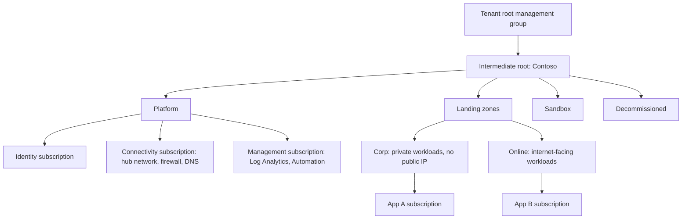

# Domain 1: Design Identity, Governance, and Monitoring Solutions (25–30%)

Official skills: design solutions for logging and monitoring · design authentication and authorization solutions · design governance.

Mental model:

```text
WHO are you?         Entra ID (authN)  → Conditional Access, MFA, passwordless, External ID
WHAT can you do?     Azure RBAC / Entra roles / app roles / managed identities (authZ)
WHERE are secrets?   Key Vault / Managed HSM (never in code or config)
WHAT is allowed?     Management groups → Policy / Defender for Cloud (compliance)
WHO should still     Entitlement management, access reviews, PIM (identity governance)
 have access?
WHAT is happening?   Azure Monitor: metrics + logs → Log Analytics → alerts, workbooks, SIEM
```

## Know This

- **Entra ID** is the identity provider for Azure. Authentication proves identity; **authorization** decides access. Keep them separate in your answer.
- **Hybrid identity sync:** **Entra Connect Sync** (full-featured, one server) vs **Entra Cloud Sync** (lightweight agent, multi-forest, disconnected forests, HA by multiple agents).
- **Sign-in methods for hybrid:** **Password hash sync (PHS)** is the default recommendation and also a leaked-credential detection source · **Pass-through authentication (PTA)** validates on-premises, no hashes in cloud · **Federation (AD FS)** is the most complex; only for needs PHS/PTA can't meet (for example smart cards on-premises).
- **Conditional Access** needs **Entra ID P1**. **Identity Protection** (risk-based) and **PIM** need **P2**. **Entra ID Governance** (entitlement management, access reviews, lifecycle workflows) is an add-on licence.
- **Managed identities** remove credentials from code: **system-assigned** (tied to one resource) vs **user-assigned** (standalone, shared by many resources).
- **Key Vault**: Standard (software) / Premium (HSM-backed keys). **Managed HSM**: single-tenant, FIPS 140-3 Level 3, full key-custody control.
- **Azure RBAC** is additive, inherited, and scoped (management group → subscription → resource group → resource). **Deny assignments** are only created by Azure (for example managed apps, deployment stacks).
- **Management group** hierarchy: up to **6 levels** (not counting the root) and a subscription has **one** parent.
- **Policy** enforces and audits resource properties. **RBAC** controls who may act. They answer different questions.
- **Log Analytics workspace** is the log store (KQL). **Diagnostic settings** send resource logs and platform metrics to Log Analytics, Storage, Event Hubs, or partner solutions.
- **Azure Monitor Agent (AMA)** with **data collection rules (DCRs)** replaces the legacy Log Analytics (MMA) agent.

## Understand This

- Why **one workspace** is the default and when you split (data sovereignty, separate billing, separate access, different retention).
- Why **managed identity + RBAC** beats a stored secret, and why Key Vault is still needed for third-party secrets.
- Why governance is built **top-down** (management groups → Policy → RBAC) and not resource by resource.
- Why **PIM** (just-in-time) and **access reviews** (periodic) solve different problems: standing access vs stale access.

---

## 1. Design solutions for logging and monitoring

### What is it?

Telemetry has three jobs: **detect** (alerts), **diagnose** (logs, traces) and **audit/secure** (SIEM). Azure Monitor collects **metrics** (numeric, near real time, cheap) and **logs** (rich records, KQL) from Azure, hybrid and multicloud.

```text
Sources (Azure resources, VMs, apps, containers, Arc servers, on-premises)
   → Azure Monitor Agent + DCR  /  Diagnostic settings  /  App Insights SDK
      → Metrics store  and  Log Analytics workspace
         → Alerts · Workbooks · Dashboards · Managed Grafana · Export (Event Hubs / Storage)
```

### Know for AZ-305

**Recommend a logging solution**

- **Log Analytics workspace** is the central log store. Default design is **one workspace per environment/region group**; split only for a real reason.
- **Access mode:** *resource-context* (users see only logs of resources they can access) vs *workspace-context* (users see the whole workspace). Table-level RBAC for finer control.
- **Application Insights** is **workspace-based**: telemetry lands in a Log Analytics workspace.
- **Retention:** interactive retention is configurable per table; **long-term retention** keeps data cheaply (up to 12 years total) and you query it with **search jobs / restore**. Use **Basic/Auxiliary log plans** for high-volume, low-value logs to save cost.
- **Activity log** (control plane: who did what to a resource) is kept in the platform for 90 days; send it to a workspace for longer retention and analysis.
- **Cost levers:** **commitment tiers** for high ingestion, **data collection rule filtering** and transformations, table plans, **daily cap** (stops ingestion; use carefully).

**Recommend a solution for routing logs**

| Need | Route to |
|---|---|
| Query, alert, dashboards | **Log Analytics workspace** |
| Cheap long-term archive, compliance | **Storage account** (lifecycle to Cool/Archive, immutability) |
| Stream to a third-party SIEM or other consumer | **Event Hubs** |
| Partner observability tool | **Partner solution** integration |
| Same logs to several places | **Several diagnostic settings** (up to 5 per resource) |
| Cross-subscription or tenant-wide | **Azure Policy** to deploy diagnostic settings (DeployIfNotExists) |
| Export from workspace to Storage/Event Hubs | **Data export rule** |
| Cross-tenant | **Azure Lighthouse** + workspace per tenant, or **Event Hubs** |

**Recommend a monitoring solution**

| Need | Recommend |
|---|---|
| Infrastructure health across Azure | **Azure Monitor metrics + alerts**, **Resource Health**, **Service Health** |
| VMs and OS-level | **VM insights** (AMA + DCR, dependency map) |
| Containers / AKS | **Container insights**, **Managed Prometheus** + **Managed Grafana** |
| Application performance and distributed tracing | **Application Insights** (OpenTelemetry-based distribution) |
| Network | **Network Watcher**, **Connection Monitor**, **Traffic Analytics** |
| Security monitoring and SIEM/SOAR | **Microsoft Sentinel** (on a Log Analytics workspace); **Defender for Cloud** for posture and workload protection |
| Custom visuals | **Workbooks** (interactive), **Dashboards**, **Managed Grafana** |
| Notify and automate | **Alerts** (metric, log search, activity log, Prometheus) → **action groups** (email, SMS, webhook, Logic App, Function, ITSM) |
| Hybrid/multicloud servers | **Azure Arc** + AMA |

### Common confusion

| Question | Answer |
|---|---|
| Metrics or logs for fast alerting? | **Metrics** (near real time, low cost). Logs for rich queries. |
| Log Analytics vs Azure Data Explorer? | LA for operational/security logs in Azure Monitor; **ADX** for very large custom telemetry analytics with custom schema. |
| Where do I see who deleted a VM? | **Activity log**. |
| Do VMs send logs by themselves? | No. Install **AMA** and attach a **DCR**; platform metrics are automatic, guest logs are not. |
| Sentinel vs Defender for Cloud? | **Sentinel** = SIEM/SOAR across everything; **Defender for Cloud** = CSPM + workload protection for cloud resources. |

> [!WARNING]
> **Exam Trap: diagnostic settings are not automatic**
>
> Most **resource logs** are **not collected** until you create a **diagnostic setting**. Platform metrics and the activity log exist by default, resource logs do not.

> [!WARNING]
> **Exam Trap: Event Hubs vs Storage**
>
> "Send to a third-party SIEM" = **Event Hubs**. "Retain cheaply for years for audit" = **Storage**. Neither replaces a Log Analytics workspace for querying.

> [!WARNING]
> **Exam Trap: legacy agents**
>
> The **Log Analytics (MMA/OMS) agent is retired**. The answer for new designs is **Azure Monitor Agent** with **data collection rules**.

### Decision table: workspace design

| Requirement | Design |
|---|---|
| One team, one region, no sovereignty rule | **Single workspace** |
| Data must stay in a country | **Workspace per region/jurisdiction** |
| Different teams must not see each other's logs | **Resource-context access + RBAC**, or separate workspaces if hard isolation is required |
| Security team needs all data | **Central workspace for Sentinel** (or cross-workspace queries) |
| Different retention per data type | **Per-table retention** (before splitting workspaces) |

### Remember

- Metrics fast, logs deep. Diagnostic settings turn resource logs on. AMA + DCR for VMs. Event Hubs = outbound stream, Storage = archive, Log Analytics = query.

---

## 2. Design authentication solutions

### What is it?

Choosing **how identities prove who they are** for employees, partners, customers and workloads, and **how on-premises identities** relate to the cloud.

### Know for AZ-305

**Recommend an authentication solution**

- **Microsoft Entra ID** for workforce identities. SSO via **OpenID Connect / OAuth 2.0 / SAML**.
- **MFA** and **passwordless** (Windows Hello for Business, **passkeys / FIDO2**, Microsoft Authenticator). **Authentication strengths** in Conditional Access enforce phishing-resistant methods.
- **Conditional Access** = signals (user, device, location, app, risk) → decision (block, require MFA, compliant device, session controls). Needs **P1**.
- **Identity Protection** adds **user risk** and **sign-in risk** policies (**P2**).
- **Security defaults** are the free baseline for tenants without Conditional Access.
- **Workload identities:** **managed identities** (Azure resources), **service principals** (apps), **workload identity federation** (GitHub Actions, Kubernetes) to avoid secrets.

**Recommend an identity management solution**

| Scenario | Recommend |
|---|---|
| Employees with on-premises AD | **Entra Connect Sync** or **Cloud Sync**, **PHS** by default |
| Many disconnected forests / M&A | **Cloud Sync** |
| Complex sync rules, device writeback, Exchange hybrid | **Entra Connect Sync** |
| Need on-prem sign-in validation, no hash in cloud | **PTA** (with **PHS as backup**) |
| Smart-card or third-party MFA requirement already built on AD FS | **Federation** (AD FS) |
| Business partners need access to your apps | **Entra B2B collaboration** (guest users; they use their own identity) |
| Customer-facing apps (consumers, social login) | **Microsoft Entra External ID** (successor to **Azure AD B2C**) |
| Legacy apps needing LDAP/Kerberos/NTLM in Azure without domain controllers | **Microsoft Entra Domain Services** |
| Apps on-premises published externally, no VPN | **Entra Application Proxy** |
| Devices | **Entra join** (cloud-first), **hybrid join** (existing AD), **registered** (BYOD) + **Intune** compliance |
| Cross-tenant organizations | **Cross-tenant access settings / cross-tenant sync** |

### Common confusion

| Question | Answer |
|---|---|
| B2B vs External ID (customers)? | **B2B** = invite external partners into **your workforce tenant**. **External ID** = a **customer identity** tenant for your apps. |
| Entra Domain Services vs AD DS on a VM? | **Domain Services** is managed, no domain controller admin; you can't extend schema or be a full domain admin. AD DS on VMs = full control, you patch and back up. |
| PHS vs PTA? | PHS = hash of hash in cloud, works if on-prem is down. PTA = validated on-prem at sign-in; on-prem must be up. |
| Entra Connect vs Cloud Sync? | Cloud Sync = lightweight agent, multi-forest, HA with several agents; Connect = more features (device writeback, pass-through ext. attributes, large complexity). |

> [!WARNING]
> **Exam Trap: Azure AD B2C vs External ID**
>
> Azure AD B2C is **no longer sold to new customers** (since May 2025). For a new customer-facing identity design, choose **Microsoft Entra External ID**. Existing B2C tenants keep working.

> [!WARNING]
> **Exam Trap: federation is rarely the answer**
>
> AD FS adds servers to run. Unless a requirement can't be met by **PHS or PTA**, the right answer is not federation.

> [!WARNING]
> **Exam Trap: licensing**
>
> Conditional Access = **P1**. Risk-based policies and PIM = **P2**. If the question says "risk-based" or "just-in-time", think **P2**.

### Remember

- PHS default. Cloud Sync for many forests. B2B partners, External ID customers. Conditional Access = P1. Workloads use managed identities.

---

## 3. Design authorization solutions (Azure and on-premises)

### What is it?

Deciding **what an authenticated identity may do**, in Azure, in your apps, and against on-premises resources.

### Know for AZ-305

**Recommend a solution for authorizing access to Azure resources**

- **Azure RBAC:** principal + role + scope. Built-in roles first, **custom roles** only if no built-in role fits. Least privilege = narrowest role at the narrowest scope.
- **ABAC (role assignment conditions)** refines RBAC with attributes (for example blob index tags, container name).
- **Management plane vs data plane:** `Contributor` manages a storage account; `Storage Blob Data Reader` reads blobs. Prefer **Entra-based data-plane roles** over keys/SAS.
- **Managed identities** for Azure-to-Azure calls; assign RBAC to the identity.
- **PIM** makes privileged role assignments **eligible** (time-bound, approval, MFA, justification) instead of permanent.
- **Entra roles** (directory: User Administrator, Global Administrator) are **separate** from Azure roles (resources). Only **Elevate access** links them for a Global Administrator.
- **Application authorization:** **App roles** and **groups claims** in tokens, **Microsoft Graph permissions** (delegated vs application), **admin consent**.
- **Azure Lighthouse** for **cross-tenant delegated management** (managed service providers).
- **Resource-level data access** for Azure services also supports **SAS** (delegated, time-limited) but SAS is not identity-based.

**Recommend a solution for authorizing access to on-premises resources**

| Need | Recommend |
|---|---|
| Cloud identities accessing on-premises web apps | **Entra Application Proxy** (+ Conditional Access, pre-authentication) |
| Cloud users accessing on-premises file/AD resources (Kerberos) | **Entra Kerberos / hybrid identity** with Entra Connect, or **Entra Domain Services** for lift-and-shift apps |
| Azure resources accessing on-premises servers | **VPN / ExpressRoute** and the on-premises identity system |
| Private network access replacing VPN | **Microsoft Entra Private Access** (Global Secure Access) |
| Arc-enabled servers calling Azure | **Managed identity of the Arc server** |
| Azure Files with AD authentication | **AD DS / Entra DS / Entra Kerberos** identity-based access |

### Common confusion

| Question | Answer |
|---|---|
| Owner vs Contributor vs User Access Administrator? | Owner = full + assign roles; Contributor = full except assigning roles; **UAA** = assign roles only. |
| Delegated vs application Graph permission? | **Delegated** acts with the signed-in user; **application** acts as the app itself with no user. |
| System- vs user-assigned managed identity? | System: lifecycle tied to one resource. **User-assigned**: reuse across many resources, survives deletion of a resource, pre-authorise once. |
| Where do I secure access to many VMs without exposing ports? | **Bastion** and **JIT VM access** (Defender for Cloud), not RBAC alone. |

> [!WARNING]
> **Exam Trap: Contributor can't grant access**
>
> A Contributor **cannot assign roles**. If the requirement is "manage resources but not grant permissions", Contributor is right. If it's "assign roles only", use **User Access Administrator** or **Role Based Access Control Administrator**.

> [!WARNING]
> **Exam Trap: Global Administrator is not an Azure Owner**
>
> Global Administrator has **no access to Azure subscriptions** by default. They must **elevate access** to get User Access Administrator at root scope.

> [!WARNING]
> **Exam Trap: prefer managed identity over secrets**
>
> If an Azure service must call another Azure service, **managed identity + RBAC** wins over client secrets, certificates in config, or SAS stored in app settings.

### Remember

- RBAC = who + role + scope. Data-plane roles over keys. PIM = eligible. Managed identity for workloads. App Proxy for on-premises web apps. Lighthouse = cross-tenant.

---

## 4. Design a solution to manage secrets, certificates, and keys

### What is it?

A central, audited place to store and use **secrets** (passwords, connection strings), **keys** (encryption keys, signing keys) and **certificates** (TLS), with rotation and no developer access to values.

### Know for AZ-305

| Option | When |
|---|---|
| **Key Vault Standard** | Secrets, certificates, software-protected keys |
| **Key Vault Premium** | Same + **HSM-protected keys** (shared HSM, FIPS 140 validated) |
| **Managed HSM** | Single-tenant HSM, **customer-controlled security domain**, highest assurance, regulatory needs |
| **App Configuration** | **Non-secret** settings, feature flags; reference Key Vault for secrets |

- **Access model:** use **Azure RBAC for Key Vault** (preferred) over legacy **access policies**. Separate **management plane** (create vault) from **data plane** (read secret).
- **Protection:** **soft delete** (always on) + **purge protection** (prevents permanent deletion during retention). Required for CMK scenarios.
- **Network:** **Private endpoint** + disable public access, or firewall + trusted services.
- **Rotation:** **Event Grid** events (near-expiry) + Function/Logic App, **auto-rotation policy** for keys, and certificate auto-renewal with integrated CAs.
- **Bring your own key (BYOK/CMK):** many services (Storage, SQL TDE, Disk encryption, Cosmos DB) accept **customer-managed keys** from Key Vault/Managed HSM.
- **Design for scale:** **one vault per application per environment per region** (limits and blast radius). Don't share one vault across prod and dev.
- **Reading secrets from apps:** **managed identity**; **Key Vault references** in App Service/Functions app settings; **CSI driver** for AKS.

### Common confusion

| Question | Answer |
|---|---|
| Key Vault vs Managed HSM? | Vault = multi-tenant service, per-operation cost. Managed HSM = dedicated single-tenant HSM pool with your security domain. |
| Key Vault vs App Configuration? | Secrets → Key Vault. Settings/flags → App Configuration. |
| Platform-managed vs customer-managed keys? | Default = Microsoft-managed. CMK = you control rotation and revoke; extra operational duty. |

> [!WARNING]
> **Exam Trap: purge protection**
>
> **Soft delete alone** doesn't stop a privileged user from purging. For **CMK-encrypted data** (Storage, SQL, disks) both **soft delete and purge protection** must be on.

> [!WARNING]
> **Exam Trap: secrets in config**
>
> "Store connection strings securely for an App Service" = **Key Vault + managed identity + Key Vault reference**, not app settings with plain values.

### Remember

- Key Vault for secrets/keys/certs. Managed HSM = single-tenant. RBAC model. Soft delete + purge protection. Managed identity reads.

---

## 5. Design governance: management groups, subscriptions, resource groups, tagging

### What is it?

The **structure** that lets policy, access and cost be applied **once, at scale**.



### Know for AZ-305

**Recommend a structure for management groups, subscriptions and resource groups**

- **Management groups** hold **Policy and RBAC** that inherit to every child subscription. Keep the hierarchy **shallow** and based on **policy needs**, not the org chart.
- **Subscriptions** are the **unit of scale, billing, quota and isolation**. Use separate subscriptions for **prod vs non-prod**, for **platform vs workload**, and when limits or quotas are reached.
- **Resource groups** = **lifecycle** boundary. Resources that are deployed, changed and deleted together live together.
- **Azure Landing Zones (CAF)**: **platform** subscriptions (identity, connectivity, management) and **application landing zones** (workload subscriptions). **Corp** (private) vs **Online** (internet-facing).
- **Subscription vending** automates subscription creation with policies applied.
- **Naming and region:** follow the CAF **naming convention**; keep resources of one workload in the same region unless HA/DR requires otherwise.
- **Cost:** subscriptions and tags support **cost allocation**; use **Cost Management budgets** and **billing scopes**.

**Recommend a strategy for resource tagging**

- Tags are **name:value metadata** for **cost allocation, ownership, environment, automation, compliance**.
- **Tags are not inherited** by resources from the resource group or subscription. Use **Policy** (`Modify`, or *inherit a tag from the resource group*) to copy and enforce them.
- Typical set: `CostCenter`, `Owner`, `Environment`, `Application`, `DataClassification`.
- Tags are **not a security boundary**. Don't use them for access control (except **ABAC conditions** on supported data).

### Common confusion

| Question | Answer |
|---|---|
| Management group vs subscription? | MG = **grouping and policy/RBAC inheritance**; subscription = **billing and resource container**. |
| When do I need another subscription? | Quota/limit, separate billing or owner, isolation of prod, regulatory boundary. |
| Resource group per type or per app? | Per **lifecycle** (app/environment), not per resource type. |
| Template spec vs Blueprint? | **Blueprints are deprecated** (scheduled retirement July 11, 2026). Use **Template specs, Bicep, Deployment Stacks, and Policy**. |

> [!WARNING]
> **Exam Trap: tags don't flow down**
>
> Tagging a resource group **does not** tag its resources. The answer is **Azure Policy** to inherit or append tags.

> [!WARNING]
> **Exam Trap: Azure Blueprints**
>
> If an option offers **Blueprints** for new governance packaging, prefer **Policy initiatives + template specs/deployment stacks**. Blueprints are deprecated.

> [!WARNING]
> **Exam Trap: deep management group trees**
>
> Max depth is **6 levels**. A design with a management group per team is usually wrong; model **policy needs**, not org charts.

### Remember

- MG = policy/RBAC at scale. Subscription = scale + billing + isolation. RG = lifecycle. Tags don't inherit: Policy does it. Landing zones = platform + application.

---

## 6. Design a solution for managing compliance

### What is it?

Continuously **proving** that resources match standards (ISO, PCI, CIS, internal rules) and **fixing** drift.

### Know for AZ-305

- **Azure Policy:** definitions grouped in **initiatives**. Effects: **Deny**, **Audit**, **Append/Modify**, **DeployIfNotExists**, **AuditIfNotExists**, **Disabled**. Assign at **management group** scope. Use **exemptions** for exceptions. **Remediation tasks** fix existing resources for `Modify`/`DeployIfNotExists`.
- **Defender for Cloud:**
  - **CSPM** (foundational free, **Defender CSPM** paid): secure score, recommendations, attack-path analysis.
  - **CWPP** (Defender plans: Servers, Storage, SQL, Containers, App Service, Key Vault…): threat protection.
  - **Regulatory compliance dashboard** maps your resources to standards and supports **multicloud (AWS, GCP)** and on-premises via Arc.
  - **JIT VM access**, adaptive controls, file integrity monitoring (via AMA).
- **Microsoft Purview:** **data governance** (catalog, classification, lineage, sensitivity labels) and **compliance** (DLP, retention, eDiscovery). Use for **data** compliance, not for resource configuration.
- **Resource locks** (CanNotDelete, ReadOnly) protect against accidental change; they are **not** compliance controls.
- **Azure Arc** extends Policy, Defender and RBAC to **on-premises and multicloud servers, Kubernetes, SQL**.
- **Deployment Stacks** manage a set of resources as a unit and can **deny deletion/modification** outside the stack.
- **Cost governance:** Policy to restrict **SKUs/regions**, budgets, **Advisor**, reservations.

### Decision table

| Requirement | Recommend |
|---|---|
| Only allow specific regions or SKUs | **Policy (Deny)** |
| Ensure every VM has the monitoring agent | **Policy (DeployIfNotExists)** |
| Show compliance with ISO 27001 / PCI | **Defender for Cloud regulatory compliance** + Policy initiative |
| Find and classify sensitive data across Azure and M365 | **Purview** |
| Block deletion of a critical resource | **Resource lock** |
| Govern AWS/GCP and on-premises servers too | **Azure Arc** + **Defender for Cloud** |
| Standardise a landing zone deployment | **Policy initiatives + Bicep/template specs + deployment stacks** |

### Common confusion

| Question | Answer |
|---|---|
| Policy vs RBAC? | Policy = what **resources may look like**; RBAC = **who** may act. |
| Audit vs Deny? | **Audit** reports; **Deny** blocks creation/update; neither changes existing resources. |
| Defender for Cloud vs Policy? | Defender for Cloud **uses Policy** to evaluate and adds security recommendations and threat protection. |
| Purview vs Defender for Cloud? | Purview = **data** governance; Defender = **resource security** posture. |

> [!WARNING]
> **Exam Trap: policy doesn't fix existing resources**
>
> `Deny` stops **new** non-compliant changes. Existing resources stay non-compliant until **remediation** (for `Modify`/`DeployIfNotExists`) or manual fix.

> [!WARNING]
> **Exam Trap: DeployIfNotExists needs an identity**
>
> A policy with `DeployIfNotExists`/`Modify` uses a **managed identity** with the right RBAC role. Missing permission is the usual reason remediation fails.

### Remember

- Policy at management group scope. Initiatives group policies. Defender for Cloud = posture + regulatory view. Purview = data. Arc extends governance outside Azure.

---

## 7. Design identity governance

### What is it?

Making sure the **right people have the right access for the right time**, and removing access when it's no longer needed.

### Know for AZ-305

| Capability | Solves | Notes |
|---|---|---|
| **Entitlement management** (access packages) | Request/approve/expire access for employees **and external users** | Bundles groups, apps, SharePoint; lifecycle, expiry, approvals, connected organizations |
| **Access reviews** | Periodic recertification of group membership, app access, role assignments | Reviewers: owners, managers, self, specific users |
| **PIM** | **Just-in-time** privileged access for Entra and Azure roles | Eligible assignments, approval, MFA, audit, **access reviews of privileged roles** |
| **Lifecycle workflows** | Joiner / mover / leaver automation | Needs Entra ID Governance |
| **Terms of use** | Require acceptance before access | Conditional Access integration |
| **Identity Protection** | Detect risky users and sign-ins | P2 |
| **Dynamic groups / group-based licensing** | Rule-based membership | P1 |
| **Privileged access groups (PAG)** | PIM for group membership | Avoid permanent membership |

- **Break-glass (emergency) accounts**: two cloud-only accounts excluded from Conditional Access (monitored) in case of lockout.
- **Guest governance:** B2B guests with **access reviews**, **entitlement management** expiry, and **cross-tenant access settings**.
- **Privileged access strategy:** **separate admin accounts**, **PIM**, **Conditional Access for admins**, **Privileged Access Workstations**.

### Common confusion

| Question | Answer |
|---|---|
| PIM vs access reviews? | PIM = **time-bound/eligible** access. Reviews = **recertify** existing access periodically. |
| Entitlement management vs PIM? | Entitlement management = **access to resources/groups/apps** for people (esp. external). PIM = **privileged roles** (admin). |
| Access review vs Conditional Access? | Review = **who still needs access**; CA = **under what conditions** access is granted. |

> [!WARNING]
> **Exam Trap: external users**
>
> "Partner users need time-limited access to apps and must be removed automatically" = **entitlement management** (access package with expiry) and **access reviews**, not manual guest invitations.

> [!WARNING]
> **Exam Trap: permanent admins**
>
> Standing Global Admin or Subscription Owner assignments are the wrong answer when the question says **least privilege, time-limited, or approval required**. Use **PIM eligible assignments**.

### Remember

- Entitlement management = request and expire. Reviews = recertify. PIM = just-in-time admin. Lifecycle workflows = joiner/mover/leaver. Break-glass accounts exist.

---

## Scenarios

**1. A company has three on-premises AD forests that aren't connected and wants cloud sign-in with minimal infrastructure.**
Requirement: sync several disconnected forests with light footprint. Capability: **Entra Cloud Sync** with several agents. Use **PHS** for sign-in.

**2. Developers need read-only access to production for 4 hours when investigating incidents, with approval.**
Requirement: just-in-time, approved, audited. Capability: **PIM eligible role assignment** (Reader) with approval and MFA.

**3. A web app on App Service reads a database password and a third-party API key.**
Requirement: no secrets in code or settings. Capability: **Key Vault + system-assigned managed identity + Key Vault references**, RBAC `Key Vault Secrets User`.

**4. The security team wants all subscriptions' logs in one place and wants alerts for suspicious activity, with a 7-year archive.**
Requirement: central SIEM + long archive. Capability: **diagnostic settings via Policy → central Log Analytics workspace with Sentinel**, long-term retention or **export to Storage** with immutability.

**5. A company needs every new resource to carry a `CostCenter` tag from its resource group and only allow two regions.**
Requirement: inherit tags and restrict location at scale. Capability: **management group Policy initiative** (inherit tag from RG + allowed locations).

**6. A consumer mobile app needs sign-up with social accounts.**
Requirement: customer identity. Capability: **Microsoft Entra External ID** (not B2B, not the workforce tenant).

## Quick Check

**Q1.** You must send resource logs from many subscriptions to a third-party SIEM in near real time. What do you use as the destination of the diagnostic settings?

A. Storage account  B. Event Hubs  C. Log Analytics workspace only  D. Application Insights

<details><summary>Answer</summary>

**B: Event Hubs.** It streams data to external consumers and SIEMs. Storage is for archive; Log Analytics is for querying inside Azure Monitor.

</details>

**Q2.** A company needs MFA and device compliance based on sign-in risk for administrators. Which licensing and feature set?

A. Security defaults  B. Entra ID P1 only  C. Entra ID P2 with Conditional Access and Identity Protection  D. Entra Domain Services

<details><summary>Answer</summary>

**C.** Risk-based Conditional Access requires **Identity Protection (P2)**. P1 gives Conditional Access without risk signals.

</details>

**Q3.** An Azure Function must read secrets without credentials stored anywhere. What is the best design?

A. Store the secret in app settings  B. Use a client secret in code  C. Use a managed identity with RBAC on Key Vault  D. Use an access key in Storage

<details><summary>Answer</summary>

**C.** Managed identities remove credentials from the design; Key Vault stores the values.

</details>

**Q4.** Resources in a resource group must automatically carry the group's `Environment` tag. What do you use?

A. Tags on the resource group  B. A resource lock  C. Azure Policy to inherit the tag  D. A Blueprint

<details><summary>Answer</summary>

**C.** Tags are not inherited by default. Policy (`Modify`/inherit tag) copies and enforces them. Blueprints are deprecated.

</details>

**Q5.** Business partners need access to an internal app for 90 days, then access must end automatically. Which solution?

A. Create member accounts and delete later  B. Entra B2B guests via an entitlement management access package with expiry  C. Entra Domain Services  D. Azure AD B2C

<details><summary>Answer</summary>

**B.** B2B for partners, entitlement management for approval and expiry. B2C/External ID is for customer-facing apps.

</details>
