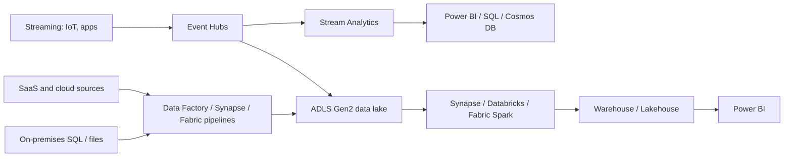

# Domain 2: Design Data Storage Solutions (20–25%)

Official skills: design data storage solutions for relational data · design data storage solutions for semi-structured and unstructured data · design data integration.

Mental model:

```text
Relational (tables, SQL, ACID)     → Azure SQL DB / SQL MI / SQL on VM / PostgreSQL / MySQL
Semi-structured (JSON, key-value,  → Cosmos DB (NoSQL, Mongo, Cassandra, Gremlin, Table), Table Storage
   graph, wide-column)
Unstructured (files, objects,      → Blob / ADLS Gen2 / Azure Files / NetApp Files / managed disks
   media, logs)
Move + transform                   → Data Factory / Synapse pipelines / Fabric / Event Hubs
Analyse                            → Synapse / Fabric / Databricks / Stream Analytics / Data Explorer
Every choice balances: features · performance · cost · protection · scale
```

## Know This

- **Azure SQL Database** = single database or elastic pool, PaaS, newest engine features. **SQL Managed Instance** = near-100% SQL Server compatibility (SQL Agent, cross-database queries, CLR, linked servers). **SQL Server on a VM** = full OS/engine control (IaaS).
- **Purchasing models:** **DTU** (bundled, simple) vs **vCore** (separate compute and storage, Hybrid Benefit, reserved capacity). vCore tiers: **General Purpose**, **Business Critical**, **Hyperscale**.
- **Serverless** compute (SQL DB, vCore) **auto-scales and auto-pauses**; billed per second for compute; best for intermittent workloads.
- **Hyperscale** = very large databases, rapid scale, **fast backups/restore**, named replicas for read scale-out.
- **Elastic pool** = many databases with **unpredictable, non-overlapping** peaks sharing resources.
- **Cosmos DB** consistency levels, strongest to weakest: **Strong · Bounded staleness · Session (default) · Consistent prefix · Eventual**.
- **Cosmos DB scale:** **partition key** drives scale and cost; **RU/s** via **provisioned**, **autoscale**, or **serverless**.
- **Blob access tiers:** **Hot, Cool (30 d), Cold (90 d), Archive (180 d, offline)**.
- **ADLS Gen2** = Blob + **hierarchical namespace** (directories, POSIX-style ACLs) for analytics.
- **Azure Files** = SMB/NFS file shares; **Azure NetApp Files** = enterprise high-performance NFS/SMB (SAP, HPC, databases); **Elastic SAN** = block storage over iSCSI.
- **Data Factory / Synapse pipelines** move and orchestrate. **Event Hubs + Stream Analytics** process streams. **Fabric** unifies lakehouse, warehouse, pipelines, and BI.
- **Encryption at rest is always on**. You decide who holds the key (**platform-managed** vs **customer-managed**).

## Understand This

- Why the **workload shape** (OLTP vs analytics vs globally distributed NoSQL vs file share) decides the service, before cost does.
- Why **PaaS** is preferred unless a requirement forces **MI** (compatibility) or **VM** (OS access).
- Why **partition key** quality in Cosmos DB matters more than provisioned throughput.
- Why **tiers** (Hot to Archive) trade **storage cost** against **access cost and latency**.

---

## 1. Design data storage solutions for relational data

### What is it?

Choosing **where relational data lives**, **how big the compute is**, **how it scales**, and **how it's protected**.

### Know for AZ-305

**Recommend a solution for storing relational data**

| Requirement | Recommend |
|---|---|
| New cloud-native app, SQL Server engine, minimal management | **Azure SQL Database** |
| Lift-and-shift SQL Server with **SQL Agent, cross-DB queries, CLR, Service Broker, linked servers** | **Azure SQL Managed Instance** |
| Needs **OS access**, third-party agents, unsupported features, specific SQL version | **SQL Server on Azure VM** |
| Open-source PostgreSQL | **Azure Database for PostgreSQL – Flexible Server** |
| Open-source MySQL | **Azure Database for MySQL – Flexible Server** |
| Oracle workloads | **Oracle Database@Azure** or Oracle on VMs |
| Data warehouse (analytical SQL) | **Synapse dedicated SQL pool** or **Fabric Warehouse** (see §4) |

**Recommend a database service tier and compute tier**

| Need | Tier |
|---|---|
| Most workloads, budget-friendly, zone redundancy optional | **General Purpose** (remote storage) |
| Low latency, high IOPS, **built-in readable replica**, highest HA | **Business Critical** (local SSD, Always On-style replicas) |
| Database **beyond GP/BC size limits** (up to **128 TB**), fast scale and restore, read scale-out via **named replicas** | **Hyperscale** |
| Intermittent usage, dev/test | **Serverless** (auto-pause) |
| Predictable steady usage | **Provisioned** compute, **reserved capacity**, **Azure Hybrid Benefit** |
| Many small databases with varying peaks (SaaS multi-tenant) | **Elastic pool** |
| Simple "bundle" pricing, small apps | **DTU** model (Basic/Standard/Premium) |

**Recommend a solution for database scalability**

- **Scale up/down** compute online (brief connection drop at the end of resize).
- **Read scale-out:** **Business Critical** and **Hyperscale** include readable replicas (`ApplicationIntent=ReadOnly`). Hyperscale has **named replicas** for isolated read workloads.
- **Elastic pools** share resources across databases.
- **Sharding** with the **elastic database tools** for horizontal scale-out across many databases (multi-tenant).
- **PostgreSQL/MySQL Flexible Server:** vertical scale; **read replicas** for read scale-out; **storage autogrow**.
- **Cosmos DB for relational-like scale:** consider if the data model fits documents and you need **multi-region writes**.

**Recommend a solution for data protection**

| Control | Use |
|---|---|
| Encryption at rest | **TDE** (on by default); **customer-managed TDE keys** in Key Vault/Managed HSM |
| Encrypt data so even DBAs can't read | **Always Encrypted** (secure enclaves for richer queries) |
| Hide data from non-privileged users at query time | **Dynamic data masking** |
| Row-level filtering by user | **Row-level security** |
| Data discovery and classification | **Data discovery & classification** / **Purview** |
| Threats and vulnerabilities | **Microsoft Defender for SQL**, **vulnerability assessment** |
| Auditing | **SQL auditing** to Log Analytics / Storage / Event Hubs |
| Network isolation | **Private endpoint**, firewall rules, **VNet rules**; MI lives **inside a VNet** (delegated subnet) |
| Authentication | **Entra ID authentication** (preferred), **managed identity**, disable SQL auth if possible |
| Backups | Automatic **PITR** (7 days by default, configurable up to 35) and **LTR** (up to 10 years); choose **backup storage redundancy** (LRS/ZRS/GRS/GZRS) |

### Common confusion

| Question | Answer |
|---|---|
| SQL DB vs MI? | **Compatibility**: needs instance-scoped features → MI. Otherwise **SQL DB** (more modern, more PaaS-y). |
| General Purpose vs Business Critical? | **BC** = local SSD + readable secondary + lower latency. **GP** = cheaper, remote storage. |
| Hyperscale vs Business Critical for read scale? | Hyperscale scales **storage and read replicas** independently and restores fast; BC has one built-in readable replica. |
| DTU vs vCore? | DTU = bundle; vCore = **transparent resources, Hybrid Benefit, reservations, Hyperscale/serverless**. |
| Always Encrypted vs TDE? | **TDE** protects files/backups at rest. **Always Encrypted** protects data from the **database engine and admins**. |
| Serverless vs provisioned? | Serverless for **spiky/idle** workloads, provisioned for **steady** ones. |

> [!WARNING]
> **Exam Trap: "need SQL Agent" or "cross-database queries"**
>
> Those phrases point to **SQL Managed Instance** (or a VM). A **single SQL Database** does not provide instance-level features. (Elastic Jobs and cross-database elastic queries exist but are not SQL Agent.)

> [!WARNING]
> **Exam Trap: "OS access"**
>
> Only **SQL Server on a VM** gives OS access. PaaS options never do. If a requirement says "install a third-party agent on the server", the answer is IaaS.

> [!WARNING]
> **Exam Trap: auto-pause and cold starts**
>
> **Serverless** auto-pauses; the first connection after a pause incurs a **resume delay**. It isn't right for latency-sensitive, always-on production workloads.

> [!WARNING]
> **Exam Trap: TDE doesn't hide data from users**
>
> TDE is **at-rest** encryption transparent to the app. To stop **DBAs/administrators** from seeing plaintext, use **Always Encrypted**.

### Remember

- SQL DB first, MI for compatibility, VM for OS access. GP vs BC vs Hyperscale. Serverless for spiky. Elastic pool for many databases. Always Encrypted protects from admins. PITR + LTR for backup.

---

## 2. Design data storage solutions for semi-structured data

### What is it?

NoSQL and flexible-schema data: documents, key-value, wide-column, graph, time series.

### Know for AZ-305

**Recommend a solution for storing semi-structured data**

| Need | Recommend |
|---|---|
| Globally distributed, low-latency (single-digit ms), elastic scale, JSON documents | **Azure Cosmos DB for NoSQL** |
| Existing MongoDB apps | **Cosmos DB for MongoDB** (RU or vCore model) |
| Cassandra workload | **Cosmos DB for Apache Cassandra** or **Azure Managed Instance for Apache Cassandra** (full control, lift-and-shift) |
| Graph traversal | **Cosmos DB for Apache Gremlin** |
| Simple key-value at lower cost | **Azure Table Storage** (or Cosmos DB for Table for global distribution and higher performance) |
| Time series / telemetry analytics | **Azure Data Explorer** (Kusto) |
| Search, vector, hybrid search | **Azure AI Search** (not a primary store) |
| In-memory cache | **Azure Cache for Redis / Azure Managed Redis** (cache, not a system of record) |

**Cosmos DB design decisions**

- **Partition key:** high cardinality, even distribution, used in most queries. Bad keys create **hot partitions**.
- **Throughput:** **Provisioned** (steady), **Autoscale** (variable, scales between 10% and 100% of max RU/s), **Serverless** (small/intermittent, single region).
- **Consistency** (account default; can relax per request):

| Level | Behaviour | Use |
|---|---|---|
| **Strong** | Linearizable; reads see latest committed write | Financial where staleness is unacceptable (not available with multi-region writes) |
| **Bounded staleness** | Reads lag by at most *K* versions or *T* time | Global apps needing predictable lag |
| **Session** (default) | Read-your-own-writes within a session | Most apps |
| **Consistent prefix** | Never out of order | Ordering matters, staleness OK |
| **Eventual** | Lowest latency and cost; no ordering guarantee | Likes, counters |

- **Global distribution:** add regions with a click; **multi-region writes** for write availability and local writes; **automatic failover** priorities for single-write accounts.
- **Backup:** **periodic** (default) or **continuous** (point-in-time restore).
- **Security:** Entra RBAC for data plane, **private endpoints**, **CMK**.

### Common confusion

| Question | Answer |
|---|---|
| Table Storage vs Cosmos DB for Table? | Table Storage = cheap, single-region **storage account** feature. **Cosmos DB for Table** = same API with **global distribution, SLAs on latency, secondary indexes**. |
| Cosmos DB vs SQL DB? | Cosmos = **elastic, globally distributed, schema-flexible**. SQL = relational, joins, strong ACID across tables. |
| Strong consistency + multi-region write? | **Not supported together.** |
| RU/s autoscale vs serverless? | **Autoscale** for variable production workloads with HA/multi-region. **Serverless** for dev/test and small spiky apps. |

> [!WARNING]
> **Exam Trap: choose the lowest consistency that satisfies the requirement**
>
> Stronger consistency means **higher latency and lower availability**. If the question doesn't demand global ordering or immediate reads, **Session** is the usual answer.

> [!WARNING]
> **Exam Trap: partition key**
>
> A "hot partition" is a **design** problem. More RU/s doesn't solve it; a better partition key (or synthetic key) does.

### Remember

- Cosmos DB for global, low-latency NoSQL. Session by default. Partition key matters. Table Storage = cheap key-value. Redis caches, it doesn't replace the store.

---

## 3. Design data storage solutions for unstructured data

### What is it?

Objects, files, media, backups, logs, data lakes and VM disks.

### Know for AZ-305

**Recommend a solution for storing unstructured data**

| Need | Recommend |
|---|---|
| Objects at massive scale (images, backups, logs) | **Blob Storage** |
| Analytics data lake, directory structure, POSIX ACLs | **ADLS Gen2** (Blob with hierarchical namespace) |
| SMB/NFS shared files for lift-and-shift, profile containers | **Azure Files** (hot/cool/transaction optimized/premium) |
| Hybrid file server cache and tiering | **Azure File Sync** |
| High-performance, low-latency NFS/SMB (SAP HANA, HPC, Oracle) | **Azure NetApp Files** |
| HPC/AI parallel file system | **Azure Managed Lustre** |
| Block storage for VMs | **Managed disks**: Standard HDD, Standard SSD, **Premium SSD**, **Premium SSD v2** (tune IOPS/throughput separately), **Ultra Disk** (highest, sub-ms) |
| SAN-like block storage over iSCSI for many VMs / AVS | **Azure Elastic SAN** |
| Queue messages (simple) | **Queue Storage** |

**Recommend a data storage solution to balance features, performance, and costs**

- **Access tiers** (Blob): **Hot** (frequent), **Cool** (≥30 d), **Cold** (≥90 d), **Archive** (≥180 d, offline, rehydrate hours). Cooler = cheaper storage, higher access cost and early-deletion fees.
- **Lifecycle management** moves blobs between tiers or deletes them by age, last access, or tags. Use it instead of scripts.
- **Premium block blob** accounts for low-latency, high-transaction workloads; **premium file shares** for databases and low-latency SMB.
- **Reserved capacity** for predictable blob/file capacity.
- **Performance:** partition design (prefix), **CDN / Front Door** caching for public content, **blob index tags** and **smart tiering** where available.
- **Security:** **Entra ID + RBAC** over keys/SAS; **private endpoints**; **immutable storage (WORM)**; **encryption scopes**, **CMK**.

**Recommend a data solution for protection and durability**

| Threat | Control |
|---|---|
| Datacenter/zone failure | **ZRS** |
| Regional failure | **GRS / GZRS** (+ **RA-** if the secondary must be readable) |
| Accidental delete/overwrite | **Soft delete** (blobs, containers, shares), **versioning**, **point-in-time restore** (block blobs) |
| Ransomware / compliance retention | **Immutable storage** (time-based retention or legal hold), **Azure Backup vaulted backup**, **resource locks** |
| Cross-region copy under your control | **Object replication** (needs versioning + change feed) |
| Share file recovery | **Share snapshots** / **Azure Backup** |

### Common confusion

| Question | Answer |
|---|---|
| Blob vs ADLS Gen2? | ADLS Gen2 **= Blob + hierarchical namespace**. Pick it for analytics (Spark, Synapse, Databricks) and POSIX ACLs. |
| Azure Files vs NetApp Files? | Files = general, cost-effective. **NetApp Files** = enterprise performance tiers, sub-ms latency, large databases. |
| Premium SSD v2 vs Ultra? | **v2** = flexible IOPS/throughput at lower cost for most demanding workloads; **Ultra** = highest ceilings and lowest latency. |
| Cool vs Cold vs Archive? | Cool 30 d, Cold 90 d, **Archive 180 d and offline**. Archive needs **rehydration**. |
| Redundancy vs backup? | Redundancy **copies deletes too**. Backup/soft delete/versioning protect against logical errors. |

> [!WARNING]
> **Exam Trap: Archive**
>
> Archive data **isn't readable** until rehydrated (hours). It's also **not supported on ZRS/GZRS** accounts. Reject Archive when the requirement is "access within minutes".

> [!WARNING]
> **Exam Trap: GRS secondary readability**
>
> **GRS/GZRS** secondary isn't readable until failover. Choose **RA-GRS/RA-GZRS** for reads from the secondary.

> [!WARNING]
> **Exam Trap: Premium accounts and redundancy**
>
> **Premium** block blob and file share accounts support **LRS and ZRS only** (no geo options).

### Remember

- Blob for objects, ADLS Gen2 for analytics, Files for SMB/NFS, NetApp Files for enterprise performance. Tiers + lifecycle for cost. Redundancy ≠ backup. Immutability for ransomware.

---

## 4. Design data integration

### What is it?

**Moving, transforming and orchestrating** data between systems and landing it where it can be analysed.



### Know for AZ-305

**Recommend a solution for data integration**

| Need | Recommend |
|---|---|
| Orchestrate ETL/ELT pipelines, 90+ connectors, hybrid (self-hosted IR) | **Azure Data Factory** |
| Pipelines plus Spark, SQL and notebooks in one workspace | **Azure Synapse Analytics** (pipelines are the ADF engine) |
| SaaS, end-to-end analytics platform (lakehouse, warehouse, pipelines, BI) | **Microsoft Fabric** |
| Big-data Spark engineering and ML | **Azure Databricks** |
| Hadoop/Spark/Kafka open-source clusters | **HDInsight** |
| Real-time ingestion at scale (millions of events/s), Kafka-compatible | **Azure Event Hubs** |
| Real-time SQL-like stream processing with a no-code/SQL editor | **Azure Stream Analytics** |
| Large-scale telemetry and log exploration | **Azure Data Explorer** |
| Data catalog, lineage, governance | **Microsoft Purview** |
| Simple event reactions (not bulk movement) | **Event Grid** (see [D4 §2](../04-infrastructure/README.md)) |

- **Landing zone:** **ADLS Gen2** with **medallion** layers (bronze/silver/gold).
- **Integration runtimes** (ADF): **Azure IR** (cloud), **Self-hosted IR** (on-premises/private network), **Azure-SSIS IR** (lift-and-shift SSIS).
- **Change capture:** ADF **CDC**, **Synapse Link** (Cosmos DB / SQL / Dataverse) for no-ETL analytics, **SQL change tracking**, and Fabric **mirroring**.

**Recommend a solution for data analysis**

| Need | Recommend |
|---|---|
| Enterprise **data warehouse** with massively parallel processing | **Synapse dedicated SQL pool** or **Fabric Warehouse** |
| Ad hoc SQL over the lake without provisioning | **Synapse serverless SQL pool** / **Fabric SQL analytics endpoint** |
| Big-data processing and ML notebooks | **Databricks / Synapse Spark / Fabric Spark** |
| Real-time dashboards | **Stream Analytics → Power BI**; **Real-Time Intelligence (Fabric)** |
| Self-service BI and semantic models | **Power BI** (Direct Lake with Fabric) |
| Operational analytics on live data without ETL | **Synapse Link**, **Fabric mirroring** |

### Common confusion

| Question | Answer |
|---|---|
| ADF vs Synapse pipelines vs Fabric pipelines? | Same pipeline concept. **ADF** = standalone integration service; **Synapse** = workspace with SQL/Spark; **Fabric** = SaaS, simplest ops. |
| Event Hubs vs Event Grid vs Service Bus? | Event Hubs = **telemetry streams**; Event Grid = **reactive events**; Service Bus = **enterprise messages** ([D4 §2](../04-infrastructure/README.md)). |
| Stream Analytics vs Databricks streaming? | SA = **simple, managed, SQL-based**; Databricks = **complex code, ML, Spark**. |
| Dedicated vs serverless SQL pool? | Dedicated = **provisioned DW, predictable, high concurrency**; serverless = **pay per query**, ad hoc. |

> [!WARNING]
> **Exam Trap: Data Factory is not a message broker**
>
> ADF **orchestrates batch/scheduled data movement**. For real-time event ingestion use **Event Hubs**, not ADF.

> [!WARNING]
> **Exam Trap: on-premises sources**
>
> ADF reaching a private/on-premises source requires a **self-hosted integration runtime**. The Azure IR can't reach private networks without managed VNet/private endpoints.

> [!WARNING]
> **Exam Trap: Synapse Link vs ETL**
>
> If the requirement is "analytics on operational data **without impacting** the transactional workload and without building ETL", answer **Synapse Link / mirroring**.

### Remember

- ADF/Synapse/Fabric pipelines for batch. Event Hubs + Stream Analytics for real time. ADLS Gen2 as the lake. Self-hosted IR for on-premises. Synapse Link = no-ETL analytics.

---

## Scenarios

**1. A company lifts a SQL Server estate with SQL Agent jobs and cross-database queries to Azure with minimal changes.**
Requirement: compatibility, PaaS. Capability: **SQL Managed Instance** (use the **Link** feature or **DMS** to migrate).

**2. A SaaS provider hosts 500 customer databases with varying, non-overlapping peak usage.**
Requirement: cost-efficient multi-tenant relational. Capability: **Azure SQL Database elastic pool** (vCore), sharded per tenant.

**3. A retail app needs single-digit millisecond reads and writes in Europe, US and Asia, with local write capability.**
Requirement: global distribution, multi-region writes. Capability: **Cosmos DB for NoSQL** with **multi-region writes**, **Session** consistency, well-chosen partition key.

**4. Raw log files are accessed daily for 30 days, rarely for a year, and must be kept 7 years for audit.**
Requirement: tiering by age, retention. Capability: **Blob lifecycle management** Hot → Cool → Archive, with **immutable storage** if WORM is required.

**5. A big-data team needs Spark on a data lake with folder-level permissions.**
Requirement: hierarchical namespace + ACLs. Capability: **ADLS Gen2** with **Databricks/Synapse**.

**6. IoT sensors send millions of events per second; dashboards update within seconds.**
Requirement: ingest and process streams. Capability: **Event Hubs → Stream Analytics → Power BI**, raw copy to **ADLS Gen2** via **Capture**.

## Quick Check

**Q1.** An application needs SQL Server Agent and cross-database queries, and you want the least management effort. Which service?

A. Azure SQL Database single database  B. SQL Managed Instance  C. SQL Server on VM  D. Cosmos DB

<details><summary>Answer</summary>

**B.** MI supports instance-level features as PaaS. A VM also works but increases management effort.

</details>

**Q2.** You need Cosmos DB with multi-region writes. Which consistency level isn't available?

A. Session  B. Eventual  C. Strong  D. Consistent prefix

<details><summary>Answer</summary>

**C: Strong.** Strong consistency can't be used with multi-region writes.

</details>

**Q3.** A database workload is idle most nights and unpredictable during the day. You want to minimise cost. Which option?

A. Business Critical provisioned  B. Serverless General Purpose  C. SQL on VM  D. Hyperscale with named replicas

<details><summary>Answer</summary>

**B.** Serverless auto-scales and auto-pauses, billing per second of compute.

</details>

**Q4.** Archive-tier blobs must be readable within minutes when needed. What do you recommend?

A. Archive with priority rehydration  B. Cool or Cold tier  C. GRS  D. Premium file share

<details><summary>Answer</summary>

**B.** Archive requires rehydration (hours, even with high priority). Cool/Cold are online.

</details>

**Q5.** You need to query data in a data lake with SQL without provisioning compute, paying per query. What do you use?

A. Synapse dedicated SQL pool  B. Synapse serverless SQL pool  C. SQL Managed Instance  D. HDInsight

<details><summary>Answer</summary>

**B.** Serverless SQL pool is pay-per-query over ADLS Gen2 data.

</details>
