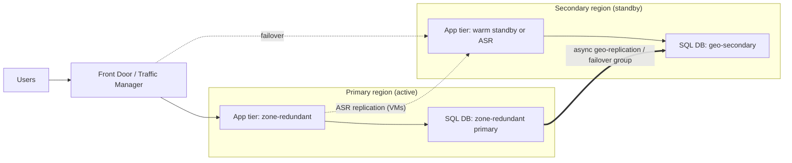

# Domain 3: Design Business Continuity Solutions (15–20%)

Official skills: design solutions for backup and disaster recovery · design for high availability.

Mental model:

```text
HA  (stay up)        = redundancy inside a region (zones, replicas)         → protects from component/zone failure
BCDR (get back up)   = backup (logical damage) + DR (region loss, failover) → protects from data loss/disaster
RTO = how long can we be down?   RPO = how much data can we lose?
Smaller RTO/RPO = more cost and complexity. Match the design to the stated objective, never beyond it.
```

## Know This

- **RTO** (recovery time objective) = acceptable downtime. **RPO** (recovery point objective) = acceptable data loss (time between last good copy and failure).
- **HA ≠ DR ≠ backup.** HA keeps the service running through local failures. DR restores service after a regional loss. Backup restores data after deletion, corruption or ransomware.
- **Composite SLA** (serial dependencies): **multiply** the SLAs. **Redundant** (parallel) paths: `1 − (1 − A) × (1 − B)`.
- **VM SLAs:** single VM with premium SSD/Ultra ≈ 99.9% · **availability set** 99.95% · **availability zones** (2+ VMs in different zones) 99.99%.
- **Azure Site Recovery (ASR)** = **replication + orchestrated failover** of VMs/physical servers (Azure-to-Azure, VMware/Hyper-V/physical-to-Azure). It is **not backup**.
- **Azure Backup** = **point-in-time backups** in a **vault**; covers VMs, SQL/SAP HANA in VMs, Azure Files, Blobs, Disks, PostgreSQL, AKS, on-premises via MARS/MABS/DPM.
- **Two vault types:** **Recovery Services vault** (VMs, SQL/HANA in VM, Files, MARS/MABS/DPM, also ASR) and **Backup vault** (Blobs, Disks, PostgreSQL, AKS, newer workloads).
- **Availability zones** = physically separate datacenters in one region. **Region pairs** = geo-DR; zones are for HA.
- **SQL Database** zone redundancy + **auto-failover groups** = zone and region resilience. **Cosmos DB** multi-region = HA and DR.
- **Storage redundancy:** **LRS** < **ZRS** < **GRS** < **GZRS**; **RA-** for readable secondary.

## Understand This

- Why **RPO** is driven by replication frequency (async replication ≈ seconds to minutes; backup ≈ hours/days).
- Why **RTO** is driven by what you've **pre-built**: hot standby (minutes), warm (tens of minutes), cold/restore (hours).
- Why **geo-redundant ≠ backed up**: replication copies **corruption and deletes**.
- Why **testing failover** is part of the design (ASR test failover doesn't disrupt production).

---

## 1. Design a recovery solution that meets recovery objectives (Azure and hybrid)

### What is it?

Choosing a **DR strategy** from the **RTO/RPO** the business gave you, for Azure, on-premises and mixed workloads.



### Know for AZ-305

**Recommend a recovery solution for Azure and hybrid workloads that meets recovery objectives**

| Strategy | RTO | RPO | Cost | Use |
|---|---|---|---|---|
| **Active-active** (multi-region, both serve traffic) | Seconds–minutes | Near zero | Highest | Mission critical, global apps (Front Door, Cosmos multi-write) |
| **Active-passive hot** (secondary always running, data replicating) | Minutes | Seconds–minutes | High | Business critical |
| **Warm standby** (scaled-down secondary, scale up on failover) | Tens of minutes | Minutes | Medium | Most business apps |
| **Cold / backup-restore** (rebuild from IaC + restore backup) | Hours–days | Hours | Lowest | Non-critical |

**Azure Site Recovery (ASR)**

- **Scenarios:** Azure VM → another Azure region · VMware/physical → Azure · Hyper-V → Azure · AWS EC2 → Azure (as physical).
- **RPO:** continuous replication (typically **seconds–minutes**); **crash-consistent** recovery points about every 5 minutes, **app-consistent** by schedule.
- **Recovery plans** orchestrate **order, scripts and manual steps** across multiple VMs/tiers (for example DB first, then app, then web).
- **Test failover** in an isolated network doesn't disturb production or replication.
- **Vault location:** for Azure-to-Azure, the **Recovery Services vault lives in the target (DR) region**.
- **Networking at DR:** pre-create the **target VNet and IP plan**; plan DNS (Traffic Manager/Front Door/Azure DNS) and use **recovery plan scripts** to update.
- **Hybrid:** **Azure Arc**, **Azure Migrate (replication appliance)** and ASR's **configuration server/process server** (for VMware physical flows).

**Design guidance**

- Define **business-criticality tiers**, set RTO/RPO per tier, then map to a strategy.
- Use **PaaS built-in features** where possible (SQL failover groups, Cosmos DB multi-region, Storage GZRS).
- Keep the DR region **in the same compliance boundary**. **Region pairs** get prioritised recovery during broad outages and sequential updates.
- Automate with **IaC** (Bicep/Terraform) so DR environments are reproducible.
- Test regularly (**Chaos Studio**, DR drills).

### Common confusion

| Question | Answer |
|---|---|
| ASR vs Azure Backup? | **ASR** = replicate and **fail over** (low RPO/RTO). **Backup** = recover **data** from a point in time (logical errors, ransomware). |
| RTO vs RPO? | RTO = **time to recover**. RPO = **data loss window**. |
| Zones vs regions? | **Zones** = HA within a region. **Regions** = DR. |
| Failover vs failback? | After the primary recovers, you **re-protect** and **fail back**. |

> [!WARNING]
> **Exam Trap: ASR is not backup**
>
> ASR replicates **current state**, so a deleted file or encrypted disk replicates too. Choose **Azure Backup** (with immutability) for logical corruption and ransomware.

> [!WARNING]
> **Exam Trap: RPO of zero**
>
> **Asynchronous** geo-replication can't promise zero data loss. Zero-RPO inside a region = **synchronous replication across zones** (ZRS, zone-redundant HA). Across regions it requires an architecture that accepts latency (for example Cosmos DB **Strong** in limited topologies).

> [!WARNING]
> **Exam Trap: composite SLA**
>
> A web app (99.95%) that depends on a database (99.99%) has a **combined** SLA of 99.95% × 99.99% ≈ **99.94%**. Adding a dependency **lowers** availability; adding redundant instances/regions **raises** it.

### Decision table

| Requirement | Recommend |
|---|---|
| IaaS VMs, RTO < 1 hour, region loss | **ASR** with recovery plans |
| PaaS web app, region loss | **Multi-region App Service behind Front Door** + replicated data tier |
| SQL DB, region loss, RPO of seconds | **Auto-failover group** |
| On-premises VMware to Azure DR | **ASR (VMware to Azure)** |
| Ransomware protection | **Backup with immutable vault + soft delete + MUA** |
| Lowest cost, RTO of days | **Backup + IaC redeploy** |

### Remember

- RTO/RPO drive everything. ASR = replicate + failover. Backup = point-in-time data. Multiply serial SLAs. Test failover first. Vault for ASR lives in the target region.

---

## 2. Design a backup and recovery solution (compute, databases, unstructured data)

### What is it?

**Protecting data from deletion, corruption and ransomware** with retention you control.

### Know for AZ-305

**Recommend a backup and recovery solution for compute**

- **Azure Backup for VMs** (agentless, extension-based): **snapshot** first (instant restore, 1–5 days locally), then **vault tier**. **Application-consistent** on Windows (VSS) and Linux (pre/post scripts).
- **Policies:** **Standard** (daily) vs **Enhanced** (multiple per day, supports **Trusted Launch**, **Premium SSD v2/Ultra**, zonal). Retention: daily/weekly/monthly/yearly.
- **Restore options:** **create new VM**, **restore disks**, **replace existing**, **file-level recovery** (mounted recovery script), **Cross Region Restore** (needs **GRS** vault).
- **Backup storage redundancy:** **LRS / ZRS / GRS** chosen **before** the first backup; change is limited afterwards.
- **On-premises servers:** **MARS agent** (files/folders/system state), **MABS / DPM** (workloads like SQL, Hyper-V, VMware).
- **AKS:** **Azure Backup for AKS** (Backup vault).
- **Region rule:** the **vault must be in the same region** as the VM (Recovery Services vault) for VM backup.

**Recommend a backup and recovery solution for databases**

| Database | Backup solution |
|---|---|
| **Azure SQL Database / MI** | **Automatic backups**: **PITR** (default 7 days, up to 35) + **LTR** (weekly/monthly/yearly, up to 10 years). Choose **backup storage redundancy** (LRS/ZRS/GRS/GZRS). **Geo-restore** from geo-redundant backups. |
| **SQL Server on VM / SAP HANA on VM** | **Azure Backup workload backup** (full/diff/log, log backups as frequent as 15 min) |
| **PostgreSQL / MySQL Flexible Server** | **Automatic backups + PITR** (7–35 days); **geo-redundant backup** option; **Azure Backup for PostgreSQL** for long-term retention |
| **Cosmos DB** | **Periodic** (default) or **Continuous** (PITR, 7 or 30 days) |

**Recommend a backup and recovery solution for unstructured data**

| Data | Solution |
|---|---|
| **Blobs** | **Soft delete + versioning + PITR** for operational protection, **vaulted backup** (Backup vault) for isolated copy, **immutable storage** for WORM |
| **Azure Files** | **Share snapshots** + **Azure Backup** (policy-based, long-term retention) |
| **Managed disks** | **Azure Backup for Disks** (incremental snapshots, Backup vault) |
| **NetApp Files** | **Snapshots, backup, cross-region replication** |
| **Cross-region copy under your control** | **Object replication** (versioning + change feed) |

**Protecting backups from attack**

- **Soft delete** for backups (default on, retention extendable), **immutable vault**, **Multi-user authorization (MUA)** using a **Resource Guard** in a separate tenant/subscription.
- **Private endpoints** for vaults, **customer-managed keys** for vault encryption.
- Use **Backup Center / Azure Business Continuity Center** for at-scale monitoring and **Azure Policy** to enforce backup.

### Common confusion

| Question | Answer |
|---|---|
| Recovery Services vault vs Backup vault? | **RSV**: VMs, SQL/HANA in VMs, Files, MARS/MABS, ASR. **Backup vault**: Blobs, Disks, PostgreSQL, AKS and newer workloads. |
| PITR vs LTR? | **PITR**: restore to any point within days (7–35). **LTR**: keep **weekly/monthly/yearly** copies up to **10 years**. |
| Snapshot vs vault tier? | Snapshot = **fast restore** (days); vault = **long-term**, isolated. |
| Soft delete vs backup? | Soft delete recovers **deleted** items; it isn't point-in-time backup. |

> [!WARNING]
> **Exam Trap: vault region**
>
> A Recovery Services vault for **VM backup** must be in the **same region** as the VM. For **ASR (Azure-to-Azure)** the vault is in the **target** region. Don't mix these up.

> [!WARNING]
> **Exam Trap: redundancy choice is up-front**
>
> Set **GRS/ZRS** on the vault **before** protecting items. Cross Region Restore requires **GRS**.

> [!WARNING]
> **Exam Trap: LTR for compliance**
>
> "Keep SQL backups for 7 years" = **long-term retention (LTR)**. PITR retention maxes at **35 days**.

### Remember

- Backup for logical damage. RSV vs Backup vault. SQL: PITR + LTR. Immutable vault + MUA vs ransomware. Choose vault redundancy first.

---

## 3. Design for high availability: compute

### What is it?

Keeping compute running through **host, rack, datacenter and maintenance** events.

### Know for AZ-305

**Recommend a high availability solution for compute**

| Level | Protects from | Notes |
|---|---|---|
| **Availability set** | Rack and maintenance (fault/update domains) | 99.95%; same datacenter; legacy approach |
| **Availability zones** | **Datacenter** failure | 99.99% with 2+ instances across zones; **zone-redundant** or **zonal** |
| **VM Scale Sets (Flexible)** | Spread across zones and fault domains, autoscale | Recommended orchestration mode |
| **Region pairs / multi-region** | Regional outage | Front Door / Traffic Manager + replicated data |
| **Proximity placement groups** | Latency (not HA) | Can conflict with zone spreading |

- **VMs:** distribute across **zones**; use **zone-redundant** Load Balancer / App Gateway v2 / Standard public IP.
- **AKS:** **multiple zones for node pools**, **Standard tier** (uptime SLA), **cluster autoscaler**, pod disruption budgets, multiple nodes per system pool.
- **App Service:** **zone redundancy** (Premium v2/v3, Isolated v2) and several instances; **multi-region** via Front Door.
- **Functions:** **Flex Consumption / Premium** with zone redundancy.
- **Container Apps:** **zone-redundant environment**.
- **Load balancing:** **Standard LB** (zone-redundant frontends), **Application Gateway v2** (zone-redundant, autoscale), **Front Door** (global), **Traffic Manager** (DNS).
- **Maintenance:** **Update Manager**, **maintenance configurations**, **scheduled events**.
- **Capacity:** **Capacity reservations** (guaranteed capacity, zonal) when failover capacity must exist.
- **Managed disks:** **ZRS disks** for cross-zone failover of shared disk/clusters.
- **Stateful clusters on VMs:** **Windows Server Failover Clustering with Azure shared disks**, **Always On AG**, load balancer (probe).

### Common confusion

| Question | Answer |
|---|---|
| Availability set vs zone? | Set = **rack/maintenance** in one datacenter. Zone = **separate datacenters**. Choose zones when available. |
| Zonal vs zone-redundant? | **Zonal** = you pin to a zone. **Zone-redundant** = Azure spreads automatically. |
| Zones vs region pairs? | Zones = HA. Pairs = DR + sequential maintenance. |
| Where does autoscale fit? | **Capacity/performance**, not a substitute for redundancy. |

> [!WARNING]
> **Exam Trap: one VM is never 99.99%**
>
> The 99.99% SLA needs **two or more instances in different zones**. A single VM tops out at **99.9%** (premium storage).

> [!WARNING]
> **Exam Trap: zones aren't region failover**
>
> Zone redundancy doesn't survive a **region** outage. Add **multi-region** for DR requirements.

> [!WARNING]
> **Exam Trap: not every region has zones**
>
> If a region has **no availability zones**, the answer falls back to **availability sets**. Read the region requirement.

### Remember

- Zones > sets. Two+ instances across zones for 99.99%. Zone-redundant LB/gateway. AKS across zones. Multi-region for DR.

---

## 4. Design for high availability: relational data

### What is it?

Keeping databases available through node, zone, and region failures with minimal data loss.

### Know for AZ-305

| Service | HA in region | Cross-region |
|---|---|---|
| **Azure SQL Database** | **GP/BC/Hyperscale: zone-redundant** option; BC has local replicas; **99.99%** (**99.995%** zone-redundant) | **Active geo-replication** (up to 4 readable secondaries) or **auto-failover groups** (group of DBs, single listener endpoint) |
| **SQL Managed Instance** | **Zone-redundant** option on GP/BC | **Auto-failover groups** between instances |
| **SQL Server on VMs** | **Always On availability groups** (zones + load balancer / Azure listener) or **FCI** with shared disks/S2D | **Distributed AG**, AG with async replica; **ASR** also works |
| **PostgreSQL / MySQL Flexible Server** | **Zone-redundant HA** (standby in another zone, sync replication) or **same-zone HA** | **Read replicas** (cross-region), **geo-redundant backup**; promote replica manually |
| **Cosmos DB (relational-like need)** | Zone redundancy + multi-region | Multi-region, automatic failover |

- **Auto-failover group:** **read-write listener** (`<name>.database.windows.net`) and **read-only listener**; failover policy **automatic** (grace period) or **manual**. Apps don't change connection strings.
- **Active geo-replication:** per database, application-managed failover; up to **4** secondaries; secondaries are **readable**.
- **Hyperscale:** HA replicas + **named replicas**; **geo replicas** for DR.
- **Read scale-out:** use `ApplicationIntent=ReadOnly`.
- **Connection resilience:** use **retry logic** (transient fault handling) in apps; failovers cause brief disconnects.

### Common confusion

| Question | Answer |
|---|---|
| Active geo-replication vs failover group? | **Failover group** = **group of DBs**, stable **listener endpoints**, policy-based. Geo-replication = **per DB**, you manage endpoints. |
| Zone-redundant vs geo-replica? | Zone-redundant = **datacenter**; geo = **region**. |
| Readable secondary in BC? | **Yes**, one **built-in** read-only replica in the same region. |
| Is PostgreSQL HA also DR? | **No**: zone-redundant HA protects the zone. **Cross-region read replica** is the DR tool. |

> [!WARNING]
> **Exam Trap: failover group endpoints**
>
> Apps should connect to the **failover group listener**, not the server name of the primary. Otherwise a failover breaks connection strings.

> [!WARNING]
> **Exam Trap: data loss on forced failover**
>
> Geo-replication is **asynchronous**. A **forced** (unplanned) failover may lose recent transactions. A **planned** failover waits for sync and has no data loss.

> [!WARNING]
> **Exam Trap: zone redundancy is a setting**
>
> Zone redundancy must be **enabled** (and may add cost on some tiers). It isn't automatic for every tier/region.

### Remember

- SQL DB: zone-redundant + failover group. MI: failover group. VM: Always On AG. PG/MySQL: zone-redundant HA + cross-region replica. Use listener endpoints.

---

## 5. Design for high availability: semi-structured and unstructured data

### What is it?

Resilient storage for NoSQL, blobs, files and disks.

### Know for AZ-305

| Service | HA / DR design |
|---|---|
| **Cosmos DB** | **Availability zones** per region + **multiple regions**; **multi-region writes** for 99.999% write/read availability; **automatic failover** for single-write accounts with priority list; **service-managed failover** |
| **Blob / ADLS Gen2** | **ZRS** (zone), **GZRS / RA-GZRS** (zone + region). **Customer-managed account failover** for GRS/GZRS (may lose recent writes; **Last Sync Time**) |
| **Azure Files** | **ZRS**, **GRS/GZRS** (standard shares), **Azure Backup** and **snapshots**; **Azure File Sync** for hybrid replication |
| **NetApp Files** | **Cross-zone and cross-region replication** |
| **Managed disks** | **ZRS disks**; **ASR** for VM+disks regional DR |
| **Event Hubs / Service Bus** | **Zone redundancy** (Standard/Premium default in zone regions), **Geo-Disaster Recovery** (metadata only for Event Hubs/Service Bus; **Geo-Replication** in Premium replicates data) |
| **Redis** | **Zone redundancy**, **active geo-replication** (Enterprise/Managed Redis) |

**Redundancy options at a glance**

| Option | Copies | Survives | Read secondary |
|---|---|---|---|
| **LRS** | 3 in one datacenter | Disk/rack | n/a |
| **ZRS** | 3 across zones | Zone failure | n/a |
| **GRS** | LRS + paired region | Region failure | No (after failover only) |
| **RA-GRS** | same | Region failure | **Yes** |
| **GZRS** | ZRS + paired region | Zone **and** region | No |
| **RA-GZRS** | same | Zone and region | **Yes** |

### Common confusion

| Question | Answer |
|---|---|
| ZRS vs GZRS? | ZRS = **zone only**; GZRS adds **paired-region copy**. |
| RA-GRS vs GRS? | **RA** = **read** from secondary anytime. |
| Customer-managed failover impact? | **Possible data loss** (async), the account becomes **LRS** in the new primary until re-enabling geo-redundancy. |
| Cosmos multi-region write vs single write? | **Multi-write** = local writes and best availability; **single write + auto failover** = simpler consistency. |

> [!WARNING]
> **Exam Trap: GRS isn't read access**
>
> If the app must **read from the secondary region during normal operation**, pick **RA-GRS / RA-GZRS**.

> [!WARNING]
> **Exam Trap: redundancy isn't protection from deletion**
>
> ZRS/GRS replicate deletes. Add **soft delete, versioning, immutability, backup**.

> [!WARNING]
> **Exam Trap: Premium storage and geo options**
>
> **Premium** block blob and file accounts support **LRS/ZRS only**. A requirement for geo-redundancy on premium performance needs another design (object replication, app-level copy).

### Remember

- Cosmos DB: zones + regions + multi-write. Blob: ZRS, GZRS, RA-GZRS. Account failover = possible data loss. Add soft delete/versioning for human error.

---

## Scenarios

**1. An e-commerce site must survive a datacenter failure with no manual action, but a region outage can tolerate a 4-hour recovery.**
Requirement: zone HA + moderate DR. Capability: **zone-redundant** App Service/VMSS, **zone-redundant SQL**, **geo-backup** with warm standby or **ASR**; accept a manual regional failover.

**2. A company runs 40 VMs on-premises on VMware and needs low-RPO DR in Azure with ordered startup.**
Requirement: hybrid DR with orchestration. Capability: **ASR (VMware to Azure)** with **recovery plans**.

**3. Ransomware protection for production VMs: attackers with admin rights must not be able to delete backups.**
Requirement: tamper-resistant backup. Capability: **Azure Backup with immutable vault, soft delete, and MUA (Resource Guard)**.

**4. A SaaS database in West Europe needs a read-write endpoint that survives regional failure without changing connection strings.**
Requirement: stable endpoint across failover. Capability: **SQL Database auto-failover group** and use the **listener**.

**5. A global game needs sub-10 ms writes in three continents and 99.999% availability.**
Requirement: multi-region writes. Capability: **Cosmos DB with multi-region writes and zone redundancy**.

**6. Reports must read last quarter's data from a second region at all times and survive a zone loss.**
Requirement: zone + region + readable secondary. Capability: **RA-GZRS**.

## Quick Check

**Q1.** Which solution gives low-RPO replication with orchestrated failover for Azure VMs to another region?

A. Azure Backup  B. Azure Site Recovery  C. Availability set  D. Snapshot copy

<details><summary>Answer</summary>

**B.** ASR replicates continuously and orchestrates failover via recovery plans. Backup restores from a point in time and has a higher RTO/RPO.

</details>

**Q2.** A web tier (99.95%) uses a database (99.99%). What is the approximate composite SLA?

A. 99.99%  B. 99.95%  C. 99.94%  D. 99.90% exactly

<details><summary>Answer</summary>

**C.** Serial dependencies multiply: 0.9995 × 0.9999 ≈ 0.9994.

</details>

**Q3.** You must keep SQL Database backups for 7 years. What do you use?

A. PITR with 35 days  B. Long-term retention (LTR)  C. Geo-restore  D. Active geo-replication

<details><summary>Answer</summary>

**B.** LTR keeps weekly/monthly/yearly backups for up to 10 years.

</details>

**Q4.** You need a 99.99% SLA for VMs in a region that has availability zones. What do you deploy?

A. One premium SSD VM  B. Two VMs in an availability set  C. Two or more VMs across availability zones  D. VMs in a proximity placement group

<details><summary>Answer</summary>

**C.** The 99.99% SLA requires two or more instances in different zones.

</details>

**Q5.** An app must read from the secondary region during normal operation and survive a zone failure. Which storage redundancy?

A. ZRS  B. GRS  C. GZRS  D. RA-GZRS

<details><summary>Answer</summary>

**D.** RA-GZRS adds zone redundancy in the primary and a readable paired-region copy.

</details>
