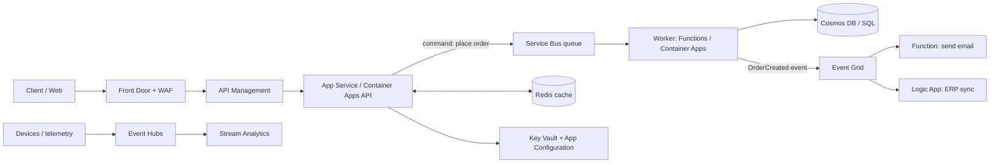
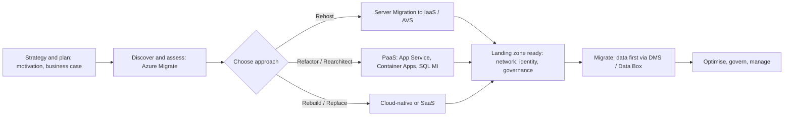
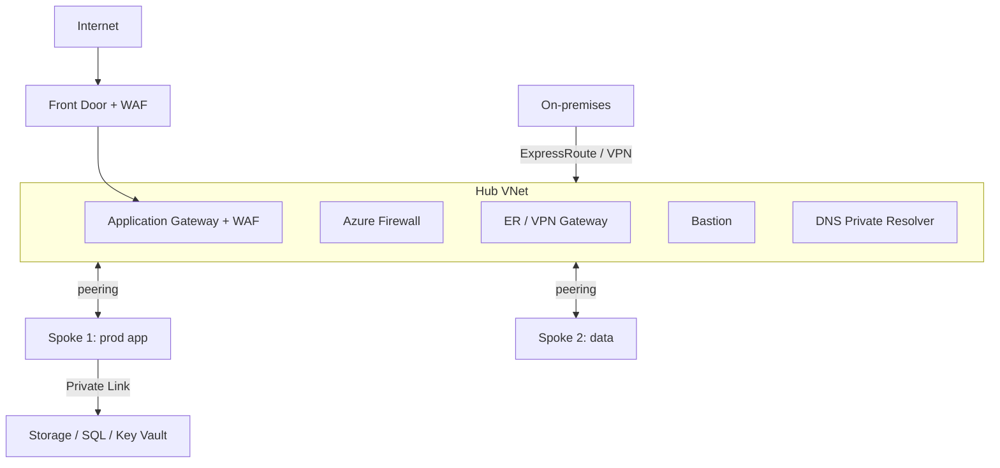

# Domain 4: Design Infrastructure Solutions (30–35%)

Official skills: design compute solutions · design an application architecture · design migrations · design network solutions.

This is the **largest domain**. Most case-study questions land here.

Mental model:

```text
Compute      = who runs the code:  VM (IaaS) → containers → App Service → serverless (least ops, least control)
App design   = how parts talk:     queue (command) · topic (pub/sub) · event grid (reaction) · event hub (stream) · API gateway
Migration    = how we get there:   assess (Azure Migrate) → choose R (rehost…replace) → move data (DMS / Data Box)
Network      = how traffic flows:  connect (VPN/ER/vWAN) → secure (NSG/Firewall/WAF/Private Link) → distribute (Front Door/AGW/LB/TM)
Every answer: pick the highest-abstraction service that still meets the requirements (less to manage = cheaper to run)
```

## Know This

- **Abstraction ladder (more control → less management):** VMs → AKS → Container Apps / App Service → Functions / Logic Apps. Prefer the **right-most that satisfies requirements**.
- **Functions hosting:** **Flex Consumption** (recommended serverless plan: VNet integration, per-instance concurrency, always-ready instances) · **Premium** (pre-warmed, VNet) · **Dedicated** (App Service plan) · classic **Consumption** (scale to zero).
- **Container Apps** = serverless containers with **KEDA** scaling, **scale to zero**, **Dapr**, revisions/traffic splitting. **AKS** = full Kubernetes control. **ACI** = simple, fast, per-second containers, no orchestration.
- **Service Bus** = enterprise **messages** (queues, topics, sessions, transactions, DLQ). **Event Hubs** = **streams** (partitions, Kafka, capture). **Event Grid** = **event notifications** (push, reactive). **Storage Queues** = simple, cheap, huge queues.
- **API Management** = front door for APIs (policies, throttling, auth, versioning, developer portal).
- **Azure Migrate** is the **hub** for discovery, assessment and server/DB/web app migration. **Data Box** = offline bulk transfer.
- **CAF migration paths:** **Rehost** (lift-and-shift) · **Refactor/Repackage** · **Rearchitect** · **Rebuild** · **Replace**.
- **Hub-spoke** (peering, you control) vs **Virtual WAN** (Microsoft-managed hubs, any-to-any, many branches).
- **VPN Gateway** = encrypted over the internet. **ExpressRoute** = private connection (not over the internet), **not encrypted by default**.
- **Front Door** = **global L7**. **Application Gateway** = **regional L7**. **Load Balancer** = **L4**. **Traffic Manager** = **DNS-based** global routing for any protocol.
- **NAT Gateway** for outbound SNAT; **Azure Firewall** for central filtering; **WAF** for web attacks; **DDoS Protection** for volumetric attacks; **Private Link** for private PaaS access.

## Understand This

- Why **managed/PaaS/serverless** wins when the question mentions "minimize operational overhead".
- Why **messaging decouples** failure and scale: a queue absorbs bursts, consumers scale independently.
- Why **migration begins with assessment**, not with moving.
- Why **network layer** (L4 vs L7) and **scope** (regional vs global) pick the load balancer, not brand names.

---

## 1. Design compute solutions

### What is it?

Matching **workload requirements** (control, scale, state, startup, cost, compliance) to a compute service.

### Know for AZ-305

**Specify components of a compute solution based on workload requirements**

| Requirement | Consider |
|---|---|
| OS-level control, legacy/COTS apps, custom drivers, licensing | **VMs** (IaaS) |
| Predictable steady load | **Reserved Instances / Savings Plan**, right-sized VMs |
| Variable, interruptible batch | **Spot VMs**, Batch low-priority/Spot nodes |
| Compliance/licensing needs dedicated hardware | **Dedicated Host** / **isolated sizes** |
| Confidential data in use | **Confidential VMs / confidential containers** |
| VMware workloads as-is | **Azure VMware Solution (AVS)** |
| GPU / AI / HPC | **N-series (GPU)**, **H-series (HPC)**, **Azure Batch / CycleCloud** |
| Autoscale and spread across zones | **VM Scale Sets (Flexible orchestration)** |
| Software licensing savings | **Azure Hybrid Benefit** |

**Recommend a virtual machine-based solution**

- **Sizes:** **B** burstable (idle/spiky) · **D** general · **E/M** memory (databases, SAP) · **F** compute · **L** storage (local NVMe) · **N** GPU · **H** HPC.
- **Disks:** **Premium SSD** (production), **Premium SSD v2** (tune IOPS/throughput independently), **Ultra** (extreme latency/IOPS), **Standard SSD/HDD** (dev/test, backups). **Encryption at host**, ADE, **CMK via disk encryption sets**.
- **Resilience:** zones, **VMSS**, availability sets (see [D3 §3](../03-business-continuity/README.md)).
- **Images and config:** **Azure Compute Gallery** (versioned, replicated images), **Image Builder**, **Machine Configuration** / **Update Manager** for patching and drift.
- **Access:** **Bastion**, **JIT**, no public IPs; **managed identity**.
- **Cost:** right-size, **auto-shutdown**, **Reservations**, **Savings Plans**, **Spot**, **Hybrid Benefit**.

**Recommend a container-based solution**

| Option | Choose when |
|---|---|
| **Azure Container Apps** | Microservices/APIs/event-driven containers **without managing Kubernetes**; scale to zero; KEDA; Dapr; jobs |
| **AKS** (Standard / **Automatic**) | Need **Kubernetes APIs**, custom operators, service mesh, complex networking, large estates. **AKS Automatic** = opinionated, less ops |
| **Azure Container Instances** | **Single/short-lived** containers, burst, simple tasks, build agents, no orchestration |
| **App Service for Containers** | One web app in a container, with App Service features (slots, auth) |
| **Azure Container Registry** | Private image store; **Premium** = geo-replication, private link, content trust |
| **Service Fabric** | Existing SF apps (legacy); not the default for new builds |

**Recommend a serverless-based solution**

| Need | Recommend |
|---|---|
| Event-driven code (HTTP, queue, timer, Event Grid, Cosmos change feed) | **Azure Functions** |
| Stateful workflows in code | **Durable Functions** |
| Low-code workflows and integration with **400+ connectors** | **Logic Apps** (**Consumption** = pay per run; **Standard** = single-tenant, VNet, stateful/stateless) |
| Static front end + serverless API | **Static Web Apps** |
| Event routing | **Event Grid** |
| Web apps without managing servers | **App Service** (PaaS) |

**Recommend a compute solution for batch processing**

| Need | Recommend |
|---|---|
| Large-scale parallel/HPC jobs, job scheduler, pools of VMs, **Spot nodes** | **Azure Batch** |
| Cluster management for HPC (Slurm, PBS, LSF) | **CycleCloud** |
| Containerised batch jobs | **Container Apps jobs**, **AKS jobs**, ACI |
| Scheduled small jobs | **Functions timer trigger**, **Logic Apps recurrence** |
| Big-data batch | **Databricks / Synapse Spark / HDInsight** ([D2 §4](../02-data-storage/README.md)) |

### Decision table: compute

| If the question says… | Think |
|---|---|
| "Minimise management", HTTP app | **App Service** |
| "Containers", "no Kubernetes expertise" | **Container Apps** |
| "Kubernetes", "operators", "Helm", "service mesh" | **AKS** |
| "Short-lived", "run once", "no orchestration" | **ACI** |
| "Event-driven", "pay only when running" | **Functions** (Flex Consumption) |
| "Workflow", "connectors", "low-code" | **Logic Apps** |
| "HPC", "thousands of cores", "job queue" | **Batch** |
| "Cannot be changed", "needs OS access" | **VM** |
| "Interruptible, cheapest" | **Spot** |

### Common confusion

| Question | Answer |
|---|---|
| Container Apps vs AKS? | **ACA** hides Kubernetes; **AKS** gives full control and more ops burden. |
| Functions vs Logic Apps? | **Code** vs **designer/connectors**. |
| Consumption vs Flex Consumption vs Premium? | Flex = modern serverless w/ VNet and always-ready; Premium = pre-warmed, no cold start, always-on instances; Consumption = legacy scale to zero. |
| App Service vs VM? | PaaS vs IaaS; App Service patches the platform for you. |
| ACI vs ACA? | **ACA** = apps with scale rules/revisions; **ACI** = single container group, no scaling features. |

> [!WARNING]
> **Exam Trap: "lift and shift" vs "modernize"**
>
> "Rehost with no code change" → **VMs (or AVS)**. "Reduce operations, app can change" → **PaaS/containers**. Don't choose AKS for simplicity.

> [!WARNING]
> **Exam Trap: cold start**
>
> Scale-to-zero (Consumption, Container Apps min 0) adds **cold-start latency**. If the requirement says **low-latency first request**, use **Premium plan/always-ready/min replicas ≥ 1**.

> [!WARNING]
> **Exam Trap: Spot VMs**
>
> **Spot** can be evicted with short notice. It's wrong for steady production or anything stateful without checkpointing.

### Remember

- VM only when you must. Container Apps for containers without K8s ops. AKS for Kubernetes. Functions/Logic Apps for events/workflows. Batch for HPC. Spot for interruptible.

---

## 2. Design an application architecture

### What is it?

How **components communicate, scale, cache, configure and deploy**.



### Know for AZ-305

**Recommend a messaging architecture**

| Service | Model | Choose when |
|---|---|---|
| **Service Bus** | Broker: **queues** (point-to-point), **topics + subscriptions** (pub/sub with filters) | **Enterprise** messaging: **FIFO via sessions**, **transactions**, **dead-letter**, **duplicate detection**, scheduled/deferred, ordering, at-least-once, **competing consumers**, high reliability |
| **Storage Queues** | Simple queue on a storage account | **Very large** queues (> 80 GB), simple, cheapest, no ordering guarantee, no topics |
| **Event Hubs** | Partitioned **log/stream**, consumer groups, **Capture** to Blob/ADLS, **Kafka endpoint** | **Telemetry/streaming** at high throughput, replay |
| **Event Grid** | **Push** event routing (HTTP, handlers, MQTT broker) | **Reactive** events (blob created, resource changed), fan-out, serverless triggers |
| **Logic Apps / Functions** | Orchestration, not a broker | Consume messages and call APIs |

- **Competing consumers**, **queue-based load leveling**, **claim check** (large payload in Blob, pointer in message), **priority queue**, **dead-letter queue**, **idempotent consumers**.
- **Command** (do X, one consumer, intent) → **queue**. **Event** (X happened, many may care) → **Event Grid / topic**. **Stream** (continuous data) → **Event Hubs**.

**Recommend an event-driven architecture**

- **Publish/subscribe** with **Event Grid** (system topics from Azure resources, custom topics, domains) or **Service Bus topics** when you need reliability features.
- **Choreography** (events) vs **orchestration** (Durable Functions/Logic Apps/**Saga**).
- Patterns: **CQRS**, **event sourcing** (Cosmos change feed / Event Hubs), **outbox** (transactional publish), **retry + circuit breaker**, **dead-lettering**.
- Handlers: **Functions**, **Logic Apps**, **Container Apps (KEDA scalers)**, **Service Bus**, **Event Hubs**, **webhooks**.

**Recommend a solution for API integration**

- **Azure API Management (APIM)**: **gateway** (policies: **rate limit/quota, JWT validation, IP filter, transformation, caching, mock**), **developer portal**, **versions and revisions**, **products/subscriptions**, **backend** integration with Functions, App Service, Logic Apps, AKS.
- **Tiers:** **Consumption** (serverless, pay per call), **Developer** (non-prod), **Basic/Standard/Premium** (classic) and **v2 tiers**. **Premium** = **multi-region**, zones, VNet injection, **self-hosted gateway** for hybrid/on-premises.
- **Self-hosted gateway** = same APIs close to on-premises backends.
- **Logic Apps** / **Integration Services** for B2B (EDI/AS2) integration.
- Secure: **OAuth/Entra ID**, **client certificates**, **managed identity to backend**, **WAF/Front Door** in front, **private endpoints/VNet**.

**Recommend a caching solution for applications**

| Need | Recommend |
|---|---|
| Low-latency in-memory cache, session store, pub/sub | **Azure Cache for Redis** / **Azure Managed Redis** (Azure Cache for Redis is being retired in favour of Managed Redis) |
| Cache static content globally | **Front Door** / **Azure CDN** |
| Cache API responses at the gateway | **API Management cache policy** |
| Cache for Cosmos DB reads | **Cosmos DB integrated cache** (dedicated gateway) |
| Pattern | **Cache-aside** (read through cache, populate on miss, set TTL) |

**Recommend an application configuration management solution**

- **Azure App Configuration**: centralised **key-values**, **labels** per environment, **feature flags**, **dynamic refresh**, **snapshots**, **Key Vault references** for secrets, **managed identity** access, Entra RBAC.
- **Key Vault** for secrets/keys/certs ([D1 §4](../01-identity-governance-monitoring/README.md)). **App Service/Functions app settings** for simple per-app config (use Key Vault references).
- **Kubernetes ConfigMaps/Secrets + CSI driver** for AKS.

**Recommend an automated deployment solution for applications**

- **CI/CD:** **GitHub Actions** or **Azure Pipelines** with **workload identity federation** (OIDC, no stored secrets).
- **IaC:** **Bicep / ARM** (declarative, idempotent, Azure-native), **Terraform** (multi-cloud), **Deployment Stacks** (lifecycle + deny settings), **template specs**.
- **Strategies:** **Blue-green** (App Service **slots swap**, Container Apps **revisions + traffic split**), **canary**, **rolling** (VMSS rolling upgrades, AKS rolling), **feature flags** (App Configuration).
- **Artifacts:** **ACR**, **Azure Artifacts**, **Compute Gallery**.
- **Environments:** **Azure Deployment Environments**, **dev/test/prod subscriptions** with Policy.
- **Quality gates:** approvals, tests, security scanning, **Defender for DevOps**.

### Decision table: messaging

| Requirement | Pick |
|---|---|
| Order processing must be **FIFO** and **transactional** | **Service Bus (sessions + transactions)** |
| Millions of device events per second, replay | **Event Hubs** |
| React when a blob is uploaded | **Event Grid** |
| Cheap simple work queue, 100 GB backlog | **Storage Queue** |
| One message to many independent consumers with filters | **Service Bus topic** (reliability) or **Event Grid** (reactive) |
| Large payload through a queue | **Claim check** (Blob + message pointer) |
| Handle poison messages | **Dead-letter queue** + alert |

### Common confusion

| Question | Answer |
|---|---|
| Service Bus vs Storage Queues? | Service Bus = **features** (FIFO, topics, DLQ, transactions). Storage Queue = **simple and cheap**, big. |
| Event Grid vs Event Hubs? | Grid = **discrete events, push, reactive**. Hubs = **continuous high-volume stream, pull**. |
| Queue vs topic? | Queue: **one consumer receives each message**. Topic: **each subscription gets a copy**. |
| APIM vs Application Gateway? | **APIM** manages **APIs** (policy, products). **App Gateway** is **L7 load balancer/WAF** for web traffic. |
| App Configuration vs Key Vault? | Settings/flags vs **secrets**. |

> [!WARNING]
> **Exam Trap: ordering**
>
> FIFO/ordering needs **Service Bus sessions** (or Event Hubs **per partition**). **Storage Queues** and **Event Grid** don't guarantee ordering.

> [!WARNING]
> **Exam Trap: Event Grid isn't for bulk streaming**
>
> Event Grid delivers **notifications**. For high-throughput telemetry, use **Event Hubs**.

> [!WARNING]
> **Exam Trap: APIM tiers**
>
> **Consumption** has no VNet injection or multi-region. For **multi-region, zones, self-hosted gateway**, the answer is **Premium** (or the appropriate v2 features).

> [!WARNING]
> **Exam Trap: Redis is a cache**
>
> A cache can be evicted or lost. It's not the **system of record**; keep data in a durable store.

### Remember

- Queue = command, topic = pub/sub, Event Grid = reaction, Event Hubs = stream. Service Bus for ordering/transactions. APIM fronts APIs. App Configuration + Key Vault. IaC + OIDC pipelines.

---

## 3. Design migrations

### What is it?

Moving **servers, apps, data and databases** to Azure with the right approach for each, guided by the **Cloud Adoption Framework (CAF)**.



### Know for AZ-305

**Evaluate a migration solution that leverages CAF**

- **CAF lifecycle:** **Strategy → Plan → Ready → Adopt (Migrate / Innovate) → Govern → Manage**, with **Secure** across them.
- **Ready:** build the **landing zone** first (identity, network, management groups, policy, monitoring).
- **Migration approaches (the "Rs"):** **Rehost** (as-is) · **Refactor** (small changes, e.g. move to PaaS) · **Rearchitect** (change architecture for cloud) · **Rebuild** (rewrite cloud-native) · **Replace** (SaaS). Also **Retire** and **Retain** during assessment.
- **Migration waves:** group workloads by dependency and risk; **move together what talks together**.

**Evaluate on-premises servers, data, and applications for migration**

| Task | Tool |
|---|---|
| Discover servers (VMware, Hyper-V, physical, AWS/GCP), performance, **dependencies** | **Azure Migrate** (appliance, agentless; **dependency analysis**) |
| Readiness, **right-sizing**, cost estimates (with **Hybrid Benefit, reservations**) | **Azure Migrate assessments** (Azure VM, **AVS**, SQL, web apps), **business case** |
| Database compatibility | **Azure Migrate SQL assessment**, SSMA |
| Web apps (.NET, PHP, Java) | **App Service migration assessment / migration assistant** |
| Containerisation of apps | **Azure Migrate app containerization** / **Containerization Assist** |

**Recommend a solution for migrating workloads to IaaS and PaaS**

| Target | When |
|---|---|
| **IaaS VMs** | Rehost; OS-level dependencies; fastest; **Azure Migrate: Server Migration** (agentless VMware, Hyper-V, agent-based physical/AWS) |
| **Azure VMware Solution** | VMware estate to Azure **without changing VMs** (vSphere tooling, HCX) |
| **App Service** | Web apps with minimal change |
| **Container Apps / AKS** | Containerised apps |
| **SQL MI / SQL DB** | Database PaaS (see below) |
| **SaaS** | Replace commodity apps (email, CRM) |
| **Azure Arc** | Keep on-premises but govern from Azure |

- **ASR** can also **migrate** VMs (replicate then failover) especially for AWS/physical.
- Plan **network connectivity**, **DNS**, **identity** (Entra Connect), **cutover windows** and **rollback**.

**Recommend a solution for migrating databases**

| Source → Target | Tool |
|---|---|
| SQL Server → SQL DB / MI / VM | **Azure Database Migration Service** (offline/online), **MI link** (near real-time, minimal downtime), **Log Replay Service**, native **backup/restore** to MI |
| SQL Server → Azure VM | Backup/restore, log shipping, **Always On** extension |
| PostgreSQL / MySQL → Flexible Server | **Migration service** in the portal / DMS |
| MongoDB → Cosmos DB for MongoDB | DMS / Azure Cosmos DB migration tools |
| Oracle / other → Azure | **SSMA** (schema conversion), DMS, or **Oracle Database@Azure** |
| Any to any, batch | **Azure Data Factory** |

- **Online** = continuous sync, **minutes of downtime**; **offline** = **downtime during copy**.
- Always **assess compatibility** and **test** first; plan **post-migration tuning** (compat level, indexes, stats).

**Recommend a solution for migrating unstructured data**

| Need | Tool |
|---|---|
| Online copy to Blob/Files, scripts | **AzCopy** |
| Managed, repeatable NFS/SMB to Blob/Files migration | **Azure Storage Mover** |
| **Offline** bulk transfer when network is too slow | **Azure Data Box** family (**Disk**, **Data Box** ~80 TB, **Heavy** hundreds of TB); **Import/Export** for your own disks |
| Hybrid, keep file server cache on-premises | **Azure File Sync** |
| Complex ETL/scheduled | **Azure Data Factory** |
| Files with ACL preservation | **Storage Mover / Robocopy / AzCopy (supports ACLs where applicable)** |
| Ongoing transfer from other clouds | **Data Factory**, **AzCopy**, **Storage Mover** (multicloud) |

- **Online vs offline rule of thumb:** if the transfer would take **more than about a week** over your available bandwidth, use **Data Box**. Use **ExpressRoute** for sustained large online transfers.

### Common confusion

| Question | Answer |
|---|---|
| Azure Migrate vs ASR? | Azure Migrate = **discover/assess/migrate** hub (uses its own replication for VMware/Hyper-V). ASR = **DR** product that can also migrate. |
| DMS vs MI link? | **DMS** = managed migration (offline/online). **MI link** = continuous replication from SQL Server to MI with **controlled cutover**. |
| Rehost vs refactor? | Rehost = **no change**. Refactor = **minor changes** to adopt PaaS. |
| AVS vs VMs? | **AVS** keeps **VMware tooling/VM format**; Azure VMs convert to **Hyper-V-based** VMs. |
| Data Box vs AzCopy? | **Offline** vs **online**. |

> [!WARNING]
> **Exam Trap: assessment before migration**
>
> If a question asks "what first?", it's **discover and assess** (Azure Migrate) and **landing zone readiness**, not move the data.

> [!WARNING]
> **Exam Trap: minimal downtime database migration**
>
> "Minimise downtime" = **online** migration (**DMS online** or **MI link**). Offline = downtime for the copy.

> [!WARNING]
> **Exam Trap: network vs Data Box**
>
> A **hundreds-of-TB** transfer over a **slow WAN** is a **Data Box** answer. A large transfer with a **fast ExpressRoute** may stay online.

### Remember

- CAF: strategy → plan → ready (landing zone) → adopt. Azure Migrate assesses and migrates. DMS/MI link for DBs. Data Box for offline. AVS for VMware as-is.

---

## 4. Design network solutions

### What is it?

**Connect** (to internet, on-premises, other VNets), **secure** (filter, inspect, isolate) and **distribute** (balance, route) traffic, with good **performance**.



### Know for AZ-305

**Recommend a connectivity solution that connects Azure resources to the internet**

- **Inbound:** **Standard public IP** (zone-redundant) on LB/App Gateway/Front Door; prefer **Front Door + WAF** for web, and no public IPs on VMs (use **Bastion**).
- **Outbound:** **NAT Gateway** (scalable SNAT, static public IPs), **Azure Firewall** (filtering + FQDN rules), Load Balancer outbound rules.
- **New VNets default to private subnets**: no implicit outbound internet. Add **NAT Gateway / Firewall / public IP** explicitly.
- **Basic SKU public IPs and Basic Load Balancer are retired**; design with **Standard**.
- **PaaS access:** **Private Link/private endpoints** (private IP), **service endpoints** (subnet to service, still public IP), **Network Security Perimeter**.

**Recommend a connectivity solution that connects Azure resources to on-premises networks**

| Option | Choose when |
|---|---|
| **Site-to-site VPN** | Encrypted over the internet, quick, cheaper, moderate bandwidth. **Active-active + BGP + zone-redundant SKUs** for HA. |
| **Point-to-site VPN** | Individual remote users/devices (Entra ID, certificate, RADIUS) |
| **ExpressRoute** | **Private, predictable latency**, higher bandwidth, compliance. **Local / Standard / Premium** SKUs. **Private peering** (VNets), **Microsoft peering** (Microsoft 365/PaaS public endpoints). **Global Reach** links on-premises sites via Microsoft backbone. **FastPath** bypasses gateway data path for performance. **ExpressRoute Direct** for 10/100 Gbps ports + **MACsec**. |
| **ExpressRoute + VPN failover** | Cost-effective resilience (VPN as backup) |
| **Dual ExpressRoute circuits / two peering locations** | Highest resilience |
| **Virtual WAN** | Many branches/sites/regions, any-to-any, SD-WAN integration, managed routing |
| **Hub-spoke with peering** | You control routing and security (Firewall/NVA in hub) |
| **Azure Route Server** | Dynamic routing (BGP) between **NVAs** and Azure |
| **Azure Virtual Network Manager** | Central **connectivity and security admin rules** at scale |
| **Entra Private Access** | Replace VPN for private app access (zero trust) |
| **Azure Arc / Bastion** | Management access without exposing ports |

- **DNS:** **Azure DNS** (public), **Private DNS zones** (linked VNets), **DNS Private Resolver** (hybrid conditional forwarding), **Private Link needs `privatelink.*` zones**.
- **Peering** is **non-transitive** (use hub gateway transit, Firewall, or vWAN). **Address spaces can't overlap**; plan IP space for on-premises and spokes.

**Recommend a solution to optimize network performance**

- **Accelerated Networking** (SR-IOV) and **VM size** (network bandwidth limit).
- **Proximity Placement Groups** for low latency between tiers (trade-off with zones).
- **Same region** for chatty components; **Front Door/CDN** to move content closer to users; **caching**.
- **ExpressRoute FastPath**, **ExpressRoute Premium/higher bandwidth**, avoid **hairpinning** through NVAs when not required.
- **Traffic Manager (performance routing)** or **Front Door (lowest latency)**.
- **Private Link** and **service endpoints** keep PaaS traffic on the **Microsoft backbone**.
- **Monitor:** **Connection Monitor**, **Network Watcher**, **Traffic Analytics**.

**Recommend a solution to optimize network security**

| Layer | Control |
|---|---|
| **Subnet/NIC** | **NSG** (stateful, priority), **ASG**, **service tags**, **Virtual Network Manager security admin rules** |
| **Central filtering** | **Azure Firewall** (**Standard/Premium**: FQDN, threat intel, **TLS inspection + IDPS** in Premium), **Firewall Manager**, **NVA** |
| **Web apps** | **WAF** on **Front Door** (global) or **Application Gateway** (regional) |
| **Volumetric attacks** | **DDoS Protection** (Network/IP protection) on public IPs (basic platform protection is automatic) |
| **PaaS exposure** | **Private endpoints**, disable public access, **Network Security Perimeter** |
| **Management access** | **Bastion**, **JIT VM access**, no public RDP/SSH |
| **Forced inspection** | **UDR** (0.0.0.0/0 → Firewall) **forced tunneling** |
| **Zero trust** | Segmentation, least privilege, **Defender for Cloud**, **Private Access** |

**Recommend a load-balancing and routing solution**

```text
Global + HTTP/S ......... Azure Front Door (L7, anycast, WAF, caching)
Global + any protocol ... Traffic Manager (DNS-based) or Cross-region Load Balancer (L4)
Regional + HTTP/S ....... Application Gateway (L7, WAF, path/multi-site, autoscale)
Regional + TCP/UDP ...... Azure Load Balancer (L4, zone-redundant)
Combine: Front Door → Application Gateway → App, for global entry + regional L7 rules
```

| Service | Layer | Scope | Notes |
|---|---|---|---|
| **Front Door** | L7 HTTP/S | Global | SSL offload, WAF, caching, path routing, **Private Link origins (Premium)** |
| **Traffic Manager** | **DNS** | Global | Any protocol; routing: **Priority, Weighted, Performance, Geographic, Multivalue, Subnet**; health probes; no proxying |
| **Application Gateway (v2)** | L7 HTTP/S | Regional | **WAF v2**, autoscale, zone-redundant, URL path routing, session affinity, mTLS, **AGIC** for AKS |
| **Load Balancer** | L4 | Regional (+ cross-region tier) | **Standard**, zone-redundant frontends, HA ports, outbound rules; **Gateway LB** for NVAs |

### Decision table: hub-spoke vs Virtual WAN

| Requirement | Pick |
|---|---|
| Few VNets, tight control of routing/NVAs | **Hub-spoke** |
| Many branches, global transit, SD-WAN, minimal routing management | **Virtual WAN** |
| Need custom NVA in the hub with your own UDRs | **Hub-spoke** (or vWAN with supported NVA integration) |
| Central security for branches and VNets | **vWAN secured hub** (Firewall Manager) |

### Common confusion

| Question | Answer |
|---|---|
| Front Door vs Traffic Manager? | Front Door **proxies** HTTP/S traffic (L7, WAF, cache). Traffic Manager **only answers DNS**; works for any protocol, no WAF/caching. |
| Application Gateway vs Load Balancer? | **L7 HTTP/S + WAF** vs **L4 TCP/UDP**. |
| VPN vs ExpressRoute? | **Encrypted over internet** vs **private circuit, not encrypted by default**. |
| Service endpoint vs private endpoint? | Endpoint keeps **public IP** and enables subnet-based firewall rule; **private endpoint** gives a **private IP** in your VNet and works from on-premises. |
| NSG vs Azure Firewall? | **NSG** = L3/L4 allow/deny per subnet/NIC. **Firewall** = central, FQDN/URL/threat intel/TLS inspection. |
| WAF on Front Door vs App Gateway? | **Global edge** vs **regional**. |

> [!WARNING]
> **Exam Trap: ExpressRoute isn't encrypted**
>
> ExpressRoute is **private**, not **encrypted**. For encryption add **MACsec (Direct)** or **IPsec VPN over ExpressRoute**.

> [!WARNING]
> **Exam Trap: peering is not transitive**
>
> Spoke-to-spoke traffic needs **a hub Firewall/NVA with UDRs**, **gateway transit** for on-premises, or **Virtual WAN**. Peering alone doesn't give transitivity.

> [!WARNING]
> **Exam Trap: Traffic Manager and HTTPS**
>
> Traffic Manager returns **DNS answers**. It does **not** terminate TLS, cache, or run WAF. Requirements for those → **Front Door**.

> [!WARNING]
> **Exam Trap: Private endpoint needs DNS**
>
> Private endpoints require the right **`privatelink` DNS zone** (and conditional forwarding for on-premises). Without DNS, clients still resolve the public address.

> [!WARNING]
> **Exam Trap: service endpoints don't work from on-premises**
>
> Service endpoints work **from the subnet** only. On-premises access to a PaaS privately → **private endpoint** over VPN/ExpressRoute.

> [!WARNING]
> **Exam Trap: Application Gateway v1**
>
> v1 is **retired**; designs use **v2** (WAF v2, zone-redundant, autoscale).

### Remember

- Front Door = global L7. App Gateway = regional L7. LB = L4. Traffic Manager = DNS. ExpressRoute = private, not encrypted. Peering isn't transitive. Private endpoint needs DNS. vWAN for many branches.

---

## Scenarios

**1. A .NET web app with a nightly spike must have minimal operations and zero downtime deployments.**
Requirement: PaaS web, slots. Capability: **App Service (Standard+/Premium) with deployment slots**, autoscale.

**2. A team has 20 microservices in containers but no Kubernetes expertise, and wants scale to zero.**
Requirement: containers, low ops, scale to zero. Capability: **Azure Container Apps** (KEDA, revisions).

**3. An order system must process orders exactly in order per customer and survive consumer crashes.**
Requirement: FIFO, reliability, transactions. Capability: **Service Bus queue with sessions** and peek-lock, dead-letter.

**4. A company needs to move 300 TB of archival data from a site with a 100 Mbps link.**
Requirement: offline bulk transfer. Capability: **Azure Data Box** (to Blob), then lifecycle tiering.

**5. A SQL Server 2016 estate with SQL Agent jobs must migrate with minutes of downtime.**
Requirement: compatibility + online migration. Capability: **SQL Managed Instance** using **MI link** or **DMS online**.

**6. A global web app needs one entry point, WAF, caching, and regional failover; backend behind regional gateways.**
Requirement: global L7 + WAF. Capability: **Front Door (WAF) → Application Gateway → app**, health probes for regional failover.

**7. 50 branch offices and 4 Azure regions need any-to-any connectivity with minimal routing work.**
Requirement: large-scale transit. Capability: **Azure Virtual WAN** with secured hubs.

## Quick Check

**Q1.** You need a messaging solution with FIFO ordering, transactions and a dead-letter queue. Which service?

A. Event Grid  B. Storage Queue  C. Service Bus  D. Event Hubs

<details><summary>Answer</summary>

**C.** Service Bus sessions, transactions and DLQ meet the needs. Storage Queues and Event Grid don't guarantee ordering.

</details>

**Q2.** A containerised API needs scale-to-zero and traffic splitting between revisions, without managing Kubernetes. What do you choose?

A. AKS  B. ACI  C. Azure Container Apps  D. Service Fabric

<details><summary>Answer</summary>

**C.** Container Apps provides KEDA scaling, scale to zero and revisions with traffic splitting.

</details>

**Q3.** Users worldwide access a web app. You need WAF, caching and global load balancing for HTTP/S. Which service?

A. Traffic Manager  B. Load Balancer  C. Application Gateway  D. Azure Front Door

<details><summary>Answer</summary>

**D.** Front Door is a global L7 service with WAF and caching. Traffic Manager is DNS only; App Gateway is regional.

</details>

**Q4.** What is the first step in a migration of an unknown on-premises VMware estate?

A. Move VMs with ASR  B. Create a Data Box order  C. Discover and assess with Azure Migrate  D. Deploy AKS

<details><summary>Answer</summary>

**C.** Discovery and assessment (dependencies, readiness, sizing, cost) come before migration, along with landing zone readiness.

</details>

**Q5.** An on-premises app needs private, predictable-latency connectivity to Azure with higher bandwidth than a VPN. Traffic must also be encrypted. Which design?

A. ExpressRoute only  B. S2S VPN only  C. ExpressRoute with MACsec or IPsec VPN over private peering  D. Service endpoints

<details><summary>Answer</summary>

**C.** ExpressRoute is private but not encrypted by default. Add MACsec (ExpressRoute Direct) or an IPsec VPN over ExpressRoute.

</details>
