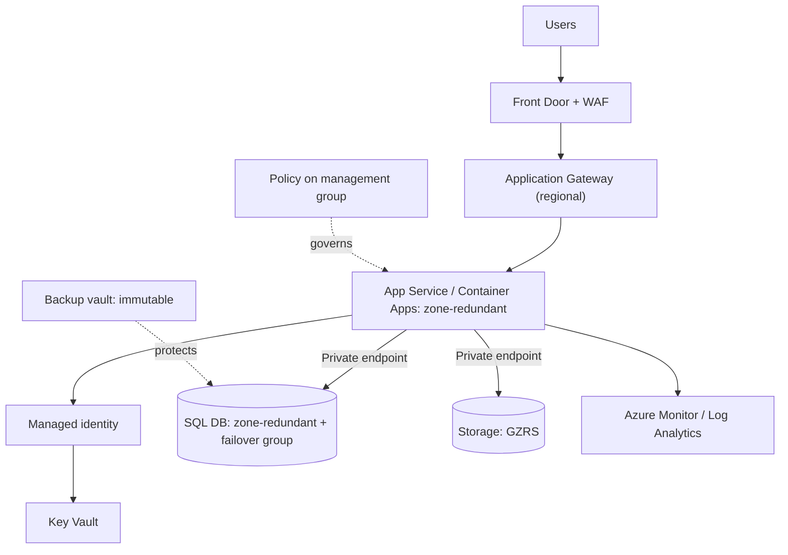

# Case Study and Design-Question Guide

AZ-305 questions describe a company, then ask you to **recommend a design**. This guide gives a repeatable method. No real exam content is included.

> Based on the Microsoft AZ-305 skills measured **as of April 17, 2026**.

## The method

1. **Read the business goal** (what the company wants to achieve).
2. **List hard requirements** (must/only/cannot): region, compliance, RTO/RPO, SLA, latency, identity source.
3. **List the preferences** ("minimise cost", "least administrative effort", "no code changes", "most secure").
4. **Map each requirement to a domain** ([identity](01-identity-governance-monitoring/README.md), [data](02-data-storage/README.md), [continuity](03-business-continuity/README.md), [infrastructure](04-infrastructure/README.md)).
5. **Pick the service per requirement** using [DECISION-MATRICES.md](DECISION-MATRICES.md).
6. **Eliminate** options that break a hard requirement.
7. Between what remains, choose the one that best matches the **preference** (usually the most managed one).
8. **Check the whole design** for conflicts: network path, identity, data residency, DR.

## Keywords and what they usually mean

| Phrase | Usual direction |
|---|---|
| "Minimize administrative effort" / "managed" | **PaaS / serverless**, not VMs |
| "Minimize cost" | Smallest tier that meets requirements, **serverless**, **Spot**, **reserved**, lifecycle tiers |
| "Least privilege" | Narrowest built-in role at the lowest scope; **PIM** for admin |
| "No secrets in code" | **Managed identity**, **Key Vault** |
| "Without changing the application" | **Rehost**, **MI**, **AVS**, **VM** |
| "Minimal downtime" | **Online** migration, replication, zone redundancy |
| "Data must remain in country" | Region choice, **Policy (allowed locations)**, no cross-region replication outside |
| "Auditing for 7 years" | **Immutable storage**, **LTR**, long retention |
| "Prevent deletion" | **Locks, soft delete, immutability** |
| "Global users" | **Front Door**, **Cosmos DB multi-region**, **CDN** |
| "Real time" | **Event Hubs + Stream Analytics**, **Event Grid** |
| "Private access to PaaS" | **Private endpoint + private DNS** |
| "From on-premises, encrypted" | **VPN**, or ExpressRoute plus encryption |
| "Hybrid" | **Arc**, **Entra Connect**, **ExpressRoute/VPN**, **ASR** |

## Well-Architected Framework pillars (use them as a checklist)

| Pillar | Ask | Typical Azure levers |
|---|---|---|
| **Reliability** | What happens when a part fails? | Zones, failover groups, ASR, health probes, retries |
| **Security** | Who can do what, and is data protected? | Entra ID, RBAC, PIM, Key Vault, private endpoints, WAF, Defender |
| **Cost optimization** | Are we paying only for what we need? | Right-sizing, serverless, reservations, Hybrid Benefit, tiering |
| **Operational excellence** | Can we deploy and observe safely? | IaC, CI/CD, Monitor, Policy, automation |
| **Performance efficiency** | Does it scale to demand? | Autoscale, caching, CDN, correct SKU, partitioning |

Questions often pit two pillars against each other (for example reliability vs cost). The **stated priority** decides.

## Cloud Adoption Framework (CAF) map

| CAF phase | Where it appears here |
|---|---|
| **Strategy / Plan** | Business case, migration waves ([D4 §3](04-infrastructure/README.md)) |
| **Ready** | Landing zones, management groups, network topology ([D1 §5](01-identity-governance-monitoring/README.md), [D4 §4](04-infrastructure/README.md)) |
| **Adopt** (migrate, innovate) | Azure Migrate, DMS, PaaS ([D4 §3](04-infrastructure/README.md)) |
| **Govern** | Policy, Defender for Cloud, cost ([D1 §6](01-identity-governance-monitoring/README.md)) |
| **Manage** | Monitoring, backup, DR ([D1 §1](01-identity-governance-monitoring/README.md), [D3](03-business-continuity/README.md)) |
| **Secure** | Identity, network, data protection across all |

## Reference architecture: the "default" enterprise answer

If a case study seems open-ended, this is a good starting shape: **global entry, regional PaaS, private data access, managed identity, central monitoring, governed by Policy, protected by Backup/DR**. Then adjust for the requirements.

## Case-study tips

- Read the **requirements and constraints tabs first**, then the existing environment. Take notes on the scratch area.
- Note **numbers**: RTO/RPO, users, data size, bandwidth, SLA targets.
- **Existing environment facts** (on-premises AD, SQL version, VMware) drive migration and identity answers.
- A requirement stated in one tab may apply to **all** questions of that case study.
- When two answers look similar, the difference is usually **one constraint** you've not applied yet.
- Don't over-design: **every extra component must be justified by a requirement**.

## Common over-engineering mistakes

| Mistake | Better |
|---|---|
| AKS for a simple web app | **App Service** |
| Multi-region for a requirement of "survive datacenter failure" | **Zone redundancy** |
| Federation (AD FS) by default | **PHS** |
| Event Hubs for a few business events | **Event Grid or Service Bus** |
| VMs for a PaaS-compatible database | **SQL DB/MI** |
| Custom role for a task a built-in role covers | **Built-in role** |
| ExpressRoute for a small branch | **S2S VPN** |
