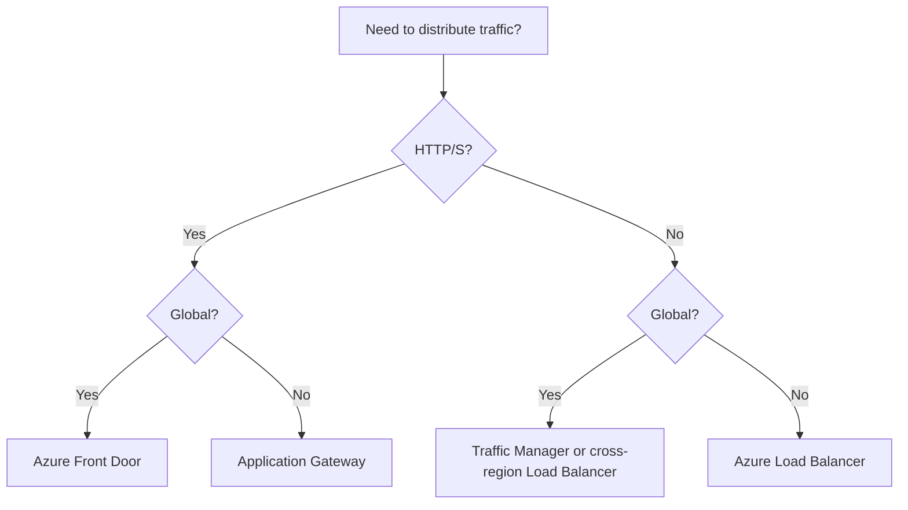

# Decision Matrices

Which service when. Use these after you have read the domain files; each row links the requirement keyword to the usual answer.

> Based on the Microsoft AZ-305 skills measured **as of April 17, 2026**.

Rule of thumb for every table: choose the option that meets **all** stated requirements with the **least operational effort** and **lowest cost**.

## Identity and security

| Requirement | Choose | Not |
|---|---|---|
| Employees sign in with on-premises credentials, simple | **Entra Connect/Cloud Sync + PHS** | AD FS unless forced |
| Many disconnected forests, light footprint | **Cloud Sync** | Entra Connect Sync |
| Partners access your apps | **Entra B2B** | New member accounts |
| Consumers sign up and sign in | **Entra External ID** | B2B, Azure AD B2C (closed to new customers) |
| Legacy apps need LDAP/Kerberos in Azure | **Entra Domain Services** | Entra ID alone |
| Publish on-premises web app externally | **Application Proxy** | Public IP on server |
| Just-in-time admin access | **PIM** | Permanent role assignment |
| Time-limited external access with approval | **Entitlement management** | Manual invites |
| Recertify access regularly | **Access reviews** | PIM |
| App needs Azure access without secrets | **Managed identity** | Client secret in config |
| Store keys, secrets, certs | **Key Vault** | App settings |
| Single-tenant HSM, full key custody | **Managed HSM** | Key Vault Standard |
| Non-secret settings and feature flags | **App Configuration** | Key Vault |
| Enforce standards at scale | **Policy at management group** | RBAC |
| Compliance dashboard for ISO/PCI | **Defender for Cloud regulatory compliance** | Policy alone |
| Discover and classify sensitive data | **Purview** | Defender for Cloud |
| Cross-tenant managed service provider | **Azure Lighthouse** | Guest accounts |

## Monitoring and logging

| Requirement | Choose |
|---|---|
| Central queryable logs | **Log Analytics workspace** |
| Stream logs to external SIEM | **Event Hubs** |
| Cheap long-term archive | **Storage account** (lifecycle, immutability) |
| VM and OS monitoring | **VM insights (AMA + DCR)** |
| Application performance | **Application Insights** |
| AKS monitoring | **Container insights** + **Managed Prometheus/Grafana** |
| SIEM/SOAR | **Microsoft Sentinel** |
| Network diagnostics | **Network Watcher / Connection Monitor** |
| Alert → notify and automate | **Alert rule → action group** |

## Relational data

| Requirement | Choose |
|---|---|
| New app, SQL engine, least management | **SQL Database** |
| SQL Agent, cross-database queries, near 100% compatibility | **SQL Managed Instance** |
| OS access, custom agents | **SQL on Azure VM** |
| Open-source PostgreSQL / MySQL | **Flexible Server** |
| Intermittent usage | **Serverless** |
| Many DBs with varying peaks | **Elastic pool** |
| Very large DB (tens of TB), fast restore/scale | **Hyperscale** |
| Lowest latency, built-in readable replica | **Business Critical** |
| Hide data from DBAs | **Always Encrypted** |
| Keep backups for years | **LTR** |

## NoSQL, files and objects

| Requirement | Choose |
|---|---|
| Global, low-latency JSON, multi-region writes | **Cosmos DB (NoSQL)** |
| MongoDB / Cassandra / Gremlin compatibility | **Cosmos DB APIs** (or Managed Instance for Cassandra for lift-and-shift) |
| Cheap key-value in a storage account | **Table Storage** |
| Objects at scale | **Blob** |
| Analytics data lake, ACLs | **ADLS Gen2** |
| SMB/NFS shares | **Azure Files** |
| Enterprise NFS/SMB, sub-ms, SAP/Oracle | **NetApp Files** |
| High-end VM disk | **Premium SSD v2 / Ultra** |
| Cache | **Azure Managed Redis / Cache for Redis** |

### Cosmos DB consistency (strong to weak)

| Level | Cost / latency | Pick when |
|---|---|---|
| **Strong** | Highest, not with multi-region writes | Never stale |
| **Bounded staleness** | High | Predictable lag across regions |
| **Session** (default) | Balanced | Most apps |
| **Consistent prefix** | Low | Order matters |
| **Eventual** | Lowest | Counters, likes |

### Blob tiers

| Tier | Min days | Access | Pick when |
|---|---|---|---|
| **Hot** | none | Online | Frequent access |
| **Cool** | 30 | Online | Infrequent |
| **Cold** | 90 | Online | Rare |
| **Archive** | 180 | **Offline** (rehydrate) | Compliance archives |

### Storage redundancy

| Need | Choose |
|---|---|
| Cheapest | **LRS** |
| Survive datacenter failure | **ZRS** |
| Survive region failure | **GRS** |
| Zone and region | **GZRS** |
| Read the secondary | **RA-GRS / RA-GZRS** |
| Premium accounts | **LRS / ZRS only** |

## Data integration and analytics

| Requirement | Choose |
|---|---|
| Batch ETL/ELT, many connectors | **Data Factory** (or Synapse/Fabric pipelines) |
| End-to-end SaaS analytics | **Microsoft Fabric** |
| Spark engineering and ML | **Databricks** |
| Telemetry ingestion (stream) | **Event Hubs** |
| Real-time SQL-style processing | **Stream Analytics** |
| Ad hoc SQL over lake, pay per query | **Synapse serverless SQL / Fabric SQL endpoint** |
| Enterprise data warehouse | **Synapse dedicated pool / Fabric Warehouse** |
| Analytics on operational data without ETL | **Synapse Link / mirroring** |

## Business continuity

| Requirement | Choose |
|---|---|
| Replicate VMs to another region, orchestrated failover | **Azure Site Recovery** |
| Point-in-time VM recovery | **Azure Backup** |
| Ransomware-resistant backups | **Immutable vault + soft delete + MUA** |
| SQL DB region failover with stable endpoint | **Auto-failover group** |
| SQL backups for 7 years | **LTR** |
| VM 99.99% SLA | **2+ VMs across zones** |
| Zone failure for PostgreSQL | **Zone-redundant HA** |
| Cosmos DB 99.999% | **Multi-region with multi-region writes** |
| Zero RPO inside a region | **Synchronous cross-zone** (ZRS, zone-redundant HA) |

### Composite SLA

```text
Serial:   A × B                 99.95% × 99.99% ≈ 99.94%
Parallel: 1 − (1 − A) × (1 − B) two 99.9% regions ≈ 99.9999%
```

## Compute

| Requirement | Choose |
|---|---|
| OS control, legacy, lift-and-shift | **VM** |
| VMware as-is | **Azure VMware Solution** |
| Web app, least management | **App Service** |
| Containers, no Kubernetes ops, scale to zero | **Container Apps** |
| Kubernetes APIs | **AKS** |
| Single short-lived container | **ACI** |
| Event-driven code | **Functions (Flex Consumption)** |
| No cold start, VNet, pre-warmed | **Functions Premium** |
| Low-code workflows, connectors | **Logic Apps** |
| HPC / large parallel jobs | **Batch / CycleCloud** |
| Cheapest interruptible | **Spot** |
| Steady, predictable | **Reservations / Savings Plan** |

## Messaging and integration

| Requirement | Choose |
|---|---|
| FIFO, transactions, DLQ, topics | **Service Bus** |
| Simple, huge, cheap queue | **Storage Queue** |
| Telemetry stream, replay, Kafka | **Event Hubs** |
| React to events (blob created) | **Event Grid** |
| Manage, secure, throttle APIs | **API Management** |
| Multi-region APIM, self-hosted gateway | **APIM Premium** |
| Large payload in a message | **Claim check** |
| Cache-aside | **Redis** |
| Blue-green web deploy | **Slots** (App Service) / **revisions** (Container Apps) |

## Migration

| Requirement | Choose |
|---|---|
| Discover, assess, size | **Azure Migrate** |
| Rehost VMs | **Azure Migrate: Server Migration** |
| VMware without change | **AVS** |
| SQL Server to MI, minimal downtime | **MI link / DMS online** |
| Schema conversion Oracle/other | **SSMA** |
| Offline bulk data | **Data Box** |
| NFS/SMB to Blob/Files, managed | **Storage Mover** |
| Scripted online copy | **AzCopy** |
| Hybrid file server | **Azure File Sync** |

## Networking

### Load balancing

| Global or regional? | HTTP(S)? | Choose |
|---|---|---|
| Global | Yes | **Front Door** |
| Global | No / any | **Traffic Manager** (DNS) or cross-region **Load Balancer** |
| Regional | Yes | **Application Gateway** |
| Regional | No | **Load Balancer** |



### Connectivity

| Requirement | Choose |
|---|---|
| Quick, encrypted, internet-based, moderate | **S2S VPN** |
| Individual remote users | **P2S VPN** (or Entra Private Access) |
| Private, predictable, high bandwidth | **ExpressRoute** |
| ExpressRoute encrypted | **MACsec (Direct) or IPsec over ER** |
| Cheap ER backup | **VPN failover** |
| Many branches and regions | **Virtual WAN** |
| Control routing and NVAs | **Hub-spoke + peering** |
| Central network policy at scale | **Azure Virtual Network Manager** |
| BGP with NVAs | **Route Server** |

### Network security and PaaS access

| Requirement | Choose |
|---|---|
| L3/L4 filter per subnet/NIC | **NSG / ASG** |
| Central FQDN, TLS inspection, IDPS | **Azure Firewall Premium** |
| Web attacks | **WAF** (Front Door or Application Gateway) |
| Volumetric attacks | **DDoS Protection** |
| PaaS with private IP, on-premises reachable | **Private endpoint** (+ private DNS) |
| Subnet-to-PaaS only, no private IP | **Service endpoint** |
| Outbound SNAT, static IPs | **NAT Gateway** |
| RDP/SSH without public IP | **Bastion / JIT** |
